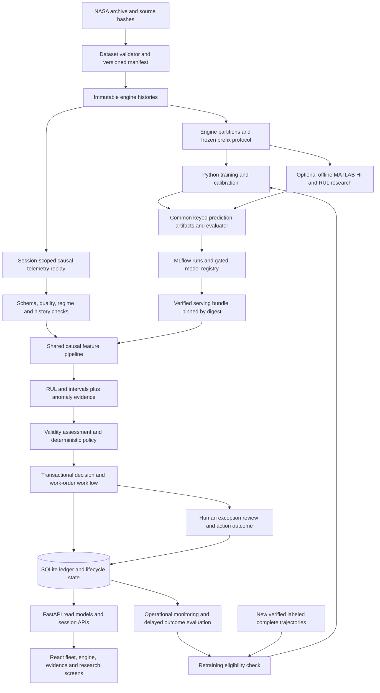
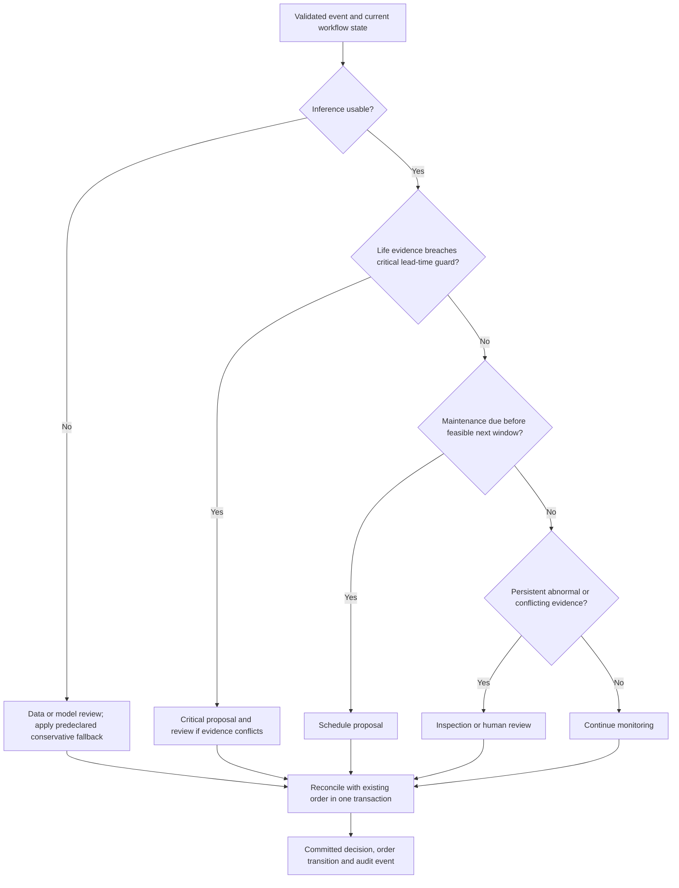

# FlairGuard AI: technical audit, research strategy and system architecture

**Review date:** 31 October 2026, Asia/Kolkata. **Status:** architecture recommendation for review; implementation has not been changed. **Scope:** the supplied workspace, official Case Study 1 and submission template, generated presentation, selected adjacent project code, installed MATLAB environment, and cited public sources.

This specification separates **verified implementation**, **saved results not independently regenerated**, **audit diagnostics**, and **proposed work**. All proposed thresholds, acceptance margins and cost ranges below are engineering choices to approve and freeze before experiments, not Tata Elxsi requirements or achieved results.

## 1. Executive Technical Verdict

FlairGuard is a useful FD001 research starter with a real dataset and several sound evaluation primitives. It is not yet an operational, scientifically validated maintenance system. Retain its causal features, engine-disjoint partitioning, correctly constructed training RUL and test-end evaluation. Redesign the anomaly experiment, quality assessment, policy simulator and work-order service before building an application around them.

The strongest evidence is the use of genuine NASA files, defensible separation of engines, and reproducible small software tests. During this review, all 14 existing tests passed. The weakest evidence is the claimed maintenance advantage: the advanced policy costs **61.00 versus 43.90** for the basic RUL policy, and the simulator counts actions that the database has suppressed. No deployable saved RUL model, functioning MLflow integration, backend, frontend or retraining pipeline exists in this workspace.

The most important findings are:

| Finding | Verdict and consequence |
|---|---|
| RUL source code | No future-sensor or engine-overlap leakage found in the inspected path; historical target construction is appropriate. Validation sampling and test governance still need correction. |
| LightGBM selection | A candidate, not an established winner. Its saved CV RMSE advantage over HistGradientBoosting is 0.0195 cycles, and it wins only two of five paired folds. |
| Anomaly benchmark | Reproduced numerical outputs, but the experiment does not establish physical fault detection. Calibration and FAR evaluation overlap; perturbations are incorrectly described and contaminate non-sensor features. |
| Uncertainty | A hard-coded ±15 cycles, unused by rule branches. It is neither calibrated prediction uncertainty nor a valid safety margin. |
| Policy evidence | The simple RUL threshold is cheaper under the current assumptions. Retain it as the operational baseline until an advanced policy earns promotion. |
| Work-order workflow | All 20 saved orders are OPEN human-review cases. Equal severity ranks block later critical updates. The simulated maintenance action and persisted state disagree. |
| MATLAB | R2026b Update 1, 95 installed products, relevant licenses available at inspection, concrete prognostics constructors verified. Use for optional offline independent prognostics, not a runtime dependency. Trial license continuity and the case study's open-source instruction matter. |
| Presentation | Six slides, broken cover layout, unsupported implementation claims, no verified submission-format compliance. Preserve it as historical material; do not submit it unchanged. |

**Unified recommendation:** one Python application package shared by batch research, replay, FastAPI and a deterministic policy; a versioned model bundle; SQLite for the initial single-writer demo; React/TypeScript for the real website; MLflow for experiment lineage; optional MATLAB experiments exchanged through fixed prediction artifacts. No Kubernetes, LLM agent, artificial turbine plant, or online training from unlabeled telemetry.

## 2. Verified Current-State Audit

### 2.1 Discovery, scope and verification strength

The active project is still at:

`C:\Users\Shaunak Rane\Desktop\Tata\FleetGuard_Phase1_Starter\FleetGuard_Phase1_Starter`

The Python namespace has been renamed to `flairguard`, version `0.2.0`; directory names and README still use FleetGuard. `fleetguard` is a four-file compatibility wrapper, not a separate model implementation.

The pre-review inventory contains **91 files, including 23 Python source files**. Every one of those Python files was read, including tests and the presentation generator. Generated bytecode and pytest cache are included in the inventory but are not source evidence. There is no Git repository under the workspace, and `git rev-parse` fails both at its root and project directory. Consequently, no local branches, commits, development-time test access history or historical source version can be verified here.

| Located component | Verified content / absence |
|---|---|
| `flairguard/` | 11 Python files: package metadata, data, features, metrics, model factories, CV, anomaly, quality, triage, storage and policy evaluation. |
| `fleetguard/` | 4 compatibility files forwarding imports to `flairguard`. |
| `scripts/` | 5 files: inspect, baseline, four-model benchmark, deck generator, anomaly/triage evaluation. |
| `tests/` | 3 files, 14 test functions. Audit execution: **14 passed in 2.78 s**. |
| `results/` | Two JSON reports, one CSV and two PNG plots. No per-engine prediction CSV, fitted weights, locked run manifest or training transcript. |
| `data/flairguard_triage.db` | SQLite tables `work_orders` and `audit_log`, one order lookup index; database integrity check passes. |
| NASA data | All FD001-FD004 train/test/RUL files, README and original modeling paper, duplicated in two locations. |
| Competition documents | All five case-study PDFs and two PPTX files. Case Study 1 read in full, with its relevant pages rendered and inspected. Other case studies are inventoried; they are not requirements for this design. |
| Model artifacts | No `.joblib`, `.pkl`, `.onnx`, `.pt`, `.h5` or other fitted model artifact found. Scripts fit in memory and discard their models. |
| MATLAB / Simulink project | No pre-existing `.m`, `.mlx`, `.mat`, `.slx` or `.mdl` project files found. New `.m` capability probe belongs only to this audit. |
| Product / MLOps | No project FastAPI service, React UI, Dockerfile, CI workflow, MLflow store or implemented drift/retraining path. FastAPI is installed in the shared interpreter; MLflow is not. |

Evidence is saved under [evidence/](evidence/): original hashes and sizes, data/database findings, pytest log, MATLAB JSON/logs, PDF text and rendered document images. The Python forensic probe fits only the small early-life anomaly detectors needed to verify the anomaly claim. **No full RUL benchmark or CV training was rerun.** Aggregate RUL metrics remain saved-result evidence, not independently reproduced model performance. A fresh NASA archive was downloaded into memory solely for hash comparison, without replacing any dataset.

### 2.2 Dataset provenance and observed sizes

All 14 files in `data/raw` match both the legacy `CMAPSSData` copy and the files in the archive retrieved from [NASA's download URL](https://data.nasa.gov/docs/legacy/CMAPSSData.zip). Archive SHA-256: `74bef434a34db25c7bf72e668ea4cd52afe5f2cf8e44367c55a82bfd91a5a34f`. Detailed comparisons are in [official_archive_check.json](evidence/official_archive_check.json).

| Subset | Train rows / engines | Test rows / engines | Operating conditions / fault modes | Test-end labels above 125 |
|---|---:|---:|---|---:|
| FD001 | 20,631 / 100 | 13,096 / 100 | 1 / 1 | 11 |
| FD002 | 53,759 / 260 | 33,991 / 259 | 6 / 1 | 57 |
| FD003 | 24,720 / 100 | 16,596 / 100 | 1 / 2 | 15 |
| FD004 | 61,249 / 249 | 41,214 / 248 | 6 / 2 | 67 |

**Provenance discrepancy:** the NASA landing-page metadata and archive README list FD004 as 248 training / 249 test engines. The verified downloaded files contain 249 / 248, matching this workspace. Use file-derived counts and hashes, and record the discrepancy rather than altering or swapping files. NASA describes independent engine trajectories, noisy readings, initial manufacturing variation, complete training lives and truncated test lives. It does not provide real maintenance-intervention outcomes. [NASA dataset description](https://data.nasa.gov/dataset/cmapss-jet-engine-simulated-data).

All four subsets pass the current loader's schema, finiteness, uniqueness and consecutive-cycle checks. This proves source-file integrity under those checks; it does not prove resilience to missing or corrupted live readings.

### 2.3 Official requirement traceability

The local four-page Case Study 1 PDF is the primary requirements source: page 2 defines layers/ground rules, page 3 defines round deliverables, and page 4 defines weights. **M** = explicit mandate; **D** = explicit deliverable; **C** = assessed criterion; **P** = proposed enhancement. The exact product names in suggested tools are optional. One subset is expressly permitted; all four are an optional extension assessed through dataset coverage.

| ID / official requirement | Existing implementation | Verified evidence | Missing functionality | Proposed design | Test / evaluation method |
|---|---|---|---|---|---|
| R01 M: ingest C-MAPSS, batch or streaming | Batch loader for all four subsets | `data.py:13-63`; verified archive hashes | Versioned source manifest; replay API | Batch source plus sequential replay from immutable dataset version | All-subset parser and hash checks; duplicate/gap/schema cases |
| R02 M: clean missing values and basic noise | Rejects non-finite source rows; rolling means | `data.py:22-23`, `features.py:27-33` | No causal imputation or operational noise policy | Short-gap forward fill with age/mask; otherwise abstain; retain raw evidence | Missing blocks/spikes at held-out engines; batch/replay parity |
| R03 M: rolling features such as averages/trends | Current sensors plus means at 5/20 cycles | 67 columns; causal tests pass | No trends; no fitted feature schema | Preserve means; test slopes and variance only through ablation | Prefix invariance, engine isolation, feature-contract tests |
| R04 M: abnormal-behavior detection | Z-score, PCA, Isolation Forest | Classes and recalculated diagnostics | Valid independent evaluation, regime handling, attribution | Train/calibrate/evaluate on separate engines using sensor residuals | Held-out nominal alert rate; labeled synthetic event delay/detection |
| R05 M: RUL prediction | Four regressors; cap 125 | Source and saved FD001 reports | Saved serving bundle; robust selection | Champion selected on frozen training-only development protocol | MAE/RMSE/NASA score on fixed populations; load/predict parity |
| R06 M: experiment and model-version tracking | CSV/JSON aggregates | Current result files | Run lineage, weights, registry | MLflow plus immutable dataset/split/config/artifact hashes | Resolve prediction to exact model and run offline |
| R07 M: simple retraining when new data arrives | None | No training orchestration or label-arrival path | Label validation, challenger evaluation, promotion | Reveal reserved complete labeled trajectories, train challenger, run gates | No new labels => no supervised retraining; rejection and rollback demo |
| R08 M/D: basic monitoring view/dashboard | Static benchmark plots | Two PNGs | Operational data/model/replay view | React fleet/engine/evidence screens backed by API | Displayed values equal API/database results |
| R09 M: lightweight rule/threshold agent, no LLM | Deterministic Python agent | `triage.py` | Validity gates and consistent contract | Pure deterministic policy returns reason codes and proposal | Boundary/conflict/action precedence tests; reproducible decision hash |
| R10 M/D: automatically raise work order, humans for exceptions | SQLite creation, suppression, close | 20 human-review rows, 3,013 events | Reliable updates, action execution, human resolution | Transactional workflow with separate priority/review status | Critical escalation, duplicate replay, crash/restart, concurrent requests |
| R11 M: handle mild failure imbalance | All-cycle RUL fitting; no failure-class model | Candidate fitting source | Explicit sampling/weighting and alert-prevalence protocol | Engine-balanced fits; report near-failure strata; no random-row SMOTE | Equal-engine metrics, precision/workload at declared event prevalence |
| R12 M: end-to-end without manual steps once data provided | Individual scripts | CLI source | One reproducible orchestrator and serving artifacts | Validated manifest -> features -> inference -> decisions -> persistence | Fresh checkout/container execution with no hidden interactive steps |
| R13 M: open-source tools and documented design | Python/scikit-learn; terse README | Requirements and imports | Accurate complete design; license manifest | Open-source production/reproduction path; optional MATLAB research appendix | Reproduce core without MATLAB; dependency/license inventory |
| R14 C: varying dataset complexity, scalable design | Loader supports FD001-004; evaluated FD001 only | Four source datasets; script choices | Regime-aware preprocessing, multi-fault evaluation | Per-subset bundles and regime-aware residualization | Matched evaluation across subsets; held-out-regime stress test |
| R15 D: Round 1 architecture, cleaning/features, model rationale, agent logic | Six-slide generated draft | PPTX text and PowerPoint renders inspected | True data-flow diagram; accurate status; verified format | Format-specific concise design artifact after portal clarification | Content-to-rubric checklist and visual inspection |
| R16 D: Round 2 working pipeline, trained RUL, dashboard, auto-order and retraining demo | Partial scripts and SQLite | No complete integrated product | Most product/operational deliverable | Single vertical slice, then research extensions | Repeatable clean-environment judge demo |
| R17 P: intervals, costs, OOD, MATLAB comparison, public website, Docker/CI | Fragments or absent | Audit findings | Validated engineering enhancements | Add only behind evidence gates below | Independent measurable benefit and operational tests |

**Differing operating conditions** are part of the dataset description and coverage criterion. The PDF does not explicitly mandate K-means, per-regime scalers or all-four training. **Observability** beyond the basic monitoring view, calibrated uncertainty, a cost simulator, MATLAB, React and cloud hosting are proposed improvements, not mandatory technologies.

### 2.4 Exact judging weights

| Round 1: Evaluation of Design | Weight | What the supplied PDF assesses |
|---|---:|---|
| Problem understanding | 15% | Accurate understanding of the problem and objectives |
| Architecture clarity | 20% | Coherent design, defined components and connections |
| Data engineering approach | 15% | Sound preparation and transformation reasoning |
| ML approach & reasoning | 20% | Suitable methods, justification, practical challenges |
| MLOps & agent logic | 15% | Practical operational plan and logical agent flow |
| Dataset coverage | 10% | Accounts for varying complexity and scales appropriately |
| Communication quality | 5% | Structured, unambiguous, internally consistent explanation |

| Round 2: Evaluation of Proof of Concept | Weight | What the supplied PDF assesses |
|---|---:|---|
| Working pipeline | 20% | End-to-end results with minimal manual intervention |
| Data engineering quality | 15% | Clean, robust, reproducible handling |
| Model performance | 15% | Credible results and sensibly interpreted metrics |
| MLOps in action | 10% | Functional, demonstrable operational elements |
| Agent behavior | 10% | Correct, reliable actions on model outputs |
| Dataset coverage | 10% | Breadth and depth relative to available complexity |
| Demo & explanation | 20% | Choices, trade-offs and improvements explained convincingly |

Each round totals 100%. Round 2's pipeline and explanation together carry 40%; a fragile system with a marginally better regressor is a poor trade.

### 2.5 Submission-format discrepancy and presentation review

The case-study PDF calls Round 1 a design/architecture slide deck but specifies no count. The supplied PowerPoint template contains two slides: a cover with case-study/team placeholders, followed by a blank branded content slide. Neither slide nor its inspected notes sets a six-slide allowance or resolves whether the cover counts.

A public Season 4 listing says Round 1 requires a single-slide PDF and Round 2 a ten-slide PPT with optional prototype/media. It is published by a college on Unstop, and its header/body contain inconsistent eligibility/deadline details. Treat it as corroboration of a possible rule, not definitive organizer authorization. [Public Season 4 listing](https://api.unstop.com/hackathons/tata-elxsi-teliport-season-4-gl-bajaj-institute-of-management-greater-noida-1767967).

The [Grad Partners event page](https://gradpartners.in/e/Tata-Elxsi-TELIPORT-Season-4-347) returned only a JavaScript shell to the web reader. Browser fallback attempts reported both the in-app browser and Chrome unavailable. The authenticated submission page, permitted slide/page count, cover/annexure rules, allowed extensions, file-size limit and current deadline were **not independently verified**. A 27 October university notice reports an extension to 1 November 2026, 23:59 IST for Round 1; that is secondary deadline evidence and must not override the registered portal. [RGUKT notice](https://hub2.rgukt.ac.in/hub/notice/index?page=0).

The six-slide draft was opened read-only through PowerPoint automation and exported to new PNGs for inspection; its source PPTX was not saved or edited.

| Slide | Review finding | Required correction after format verification |
|---|---|---|
| 1 | Severe overlapping and off-canvas title text; template styling was inherited without fitting longer text. Actual member/college details are absent. | Rebuild the title/team area within the allowed format. |
| 2 | Four component cards instead of connected architecture; claims variance filtering, validated selection, latency and retraining that source does not substantiate. | One actual data-flow diagram; mark implemented versus planned. |
| 3 | Means do not establish acceleration; variance pruning is absent; non-negative telemetry is not a valid general rule because settings may be negative; capping is a target heuristic, not demonstrated physical modeling. Test count is historical. | Describe exactly implemented features and verified test scope. |
| 4 | Aggregate values match JSON/CSV, but LightGBM selection is unsupported by the single validation split; NASA score is not a count of catastrophic failures; test access history is unknown. | Label preliminary diagnostics and selection protocol honestly; no safety-superiority inference. |
| 5 | Uses 30/50 boundaries versus actual 35/55; claims parts routing, 48-hour scheduling, sensor attribution, technician assignment, PDF work orders, hash-based deduplication, model-version logs and lifecycle feedback not implemented here. Cycles cannot be converted to hours from these files. | Align with real rule contract and separate proposals. |
| 6 | Registry, KS monitoring, automated retraining and <5 ms serialized inference are absent/unmeasured. Completing maintenance does not automatically provide true run-to-failure RUL labels. | Explain the future labeled-data and gated promotion flow; remove latency claims until measured. |

Body copy is mostly around 10 pt and chart text is tiny at projection scale. The cover alone prevents describing the draft as submission-ready. No competition submission was modified in this audit.

### 2.6 Component disposition and legitimate reuse

All actions below are recommendations for a later approved implementation phase. **Remove** means remove from the active path while archiving evidence, not delete original artifacts now.

| Existing files / component | Classification | Reason / destination |
|---|---|---|
| `flairguard/data.py` | Improve | Keep schema/RUL logic; add dataset identity, source hash and explicit engine-label mapping. Separate strict benchmark loader from operational missing-data policy. |
| `flairguard/features.py` | Retain | Correct grouped trailing means; extend with a frozen schema and streaming/batch parity before any new feature. |
| `flairguard/metrics.py` | Improve | Correct asymmetry for current error ranges; require same-shaped 1-D arrays, preserve full precision, document/remove extreme-error saturation. |
| `flairguard/models.py` | Improve | Keep four candidates; centralize configuration, optional LightGBM dependency, fit artifacts and per-subset preprocessing. |
| `flairguard/evaluation.py` | Redesign | Single GroupKFold mislabeled repeated; label-conditioned cutoffs, no predictions or manifests, no interval calibration. |
| `flairguard/anomaly.py` | Redesign | Retain simple mathematical scorers as baselines; change feature space, data partitioning and event/persistence validation. |
| `flairguard/quality.py` | Replace | Missing-key acceptance, relative-tolerance false stuck flags, unrecoverable gaps and empirical bounds mislabeled physical limits. |
| `flairguard/triage.py` | Redesign | Keep deterministic intent; split pure decision from persistence, use validity and calibrated interval contracts, remove unsupported servicing claims. |
| `flairguard/storage.py` | Redesign | Retain SQLite choice; replace concurrency/idempotency/state/version handling and escalation ordering. |
| `flairguard/policy_eval.py` | Replace | Rebuild action/outcome replay, lead times, inspections and paired policy comparisons. Preserve present results as negative evidence. |
| `flairguard/__init__.py` | Improve | Preserve identity; package and version build artifacts properly. |
| Four `fleetguard/` wrappers | Remove later | Temporary compatibility only; migrate imports and archive when no caller depends on them. They do not need independent implementations. |
| `01_inspect.py` | Retain | Useful source verification entry point; merge into dataset CLI later. |
| `02_baseline.py` | Improve | Valuable baseline recipe; separate train/validation/test commands and save artifacts. |
| `03_benchmark.py` | Redesign | Keep candidate comparison and plotting idea; stop implicit test evaluation for every iteration, stop fixed-name overwrites, save predictions/manifests. |
| `04_build_submission_deck.py` | Replace | Hard-coded metrics and claims, destructive output path and broken inherited cover. Future deck must be generated from reviewed evidence. |
| `05_anomaly_and_triage_evaluation.py` | Replace | Deletes the existing database on start; mixes CV, calibration, perturbation tests, policy and persistent state; not safe as a production workflow. |
| Three existing test files | Improve | Preserve causal and smoke tests; add meaningful failure properties and state-machine cases. They currently miss confirmed defects. |
| README / requirements / gitignore | Improve | Current README describes Phase 1, environment is unpinned, DB and outputs lack clear handling. |
| Raw data copies | Retain one canonical copy later | Both verified; deduplicate only after provenance manifest and explicit migration. Leave originals untouched now. |
| Current results, database, plots, PPTX | Retain as archive | Reclassify claimed results; never silently regenerate historical evidence in place. |
| Bytecode and pytest caches | Remove from future package | Not model artifacts or evidence; regenerate locally. |

Adjacent workspace discovery searched Python/configuration files for MLflow, grouped evaluation, anomaly and industrial-maintenance references. Selected actual source was inspected without importing or running those applications:

* `Desktop/Projects/Mini Project/src/experiment_data.py` has explicit parent/split validation, source/content hashes and dataset manifests. Adapt the **manifest and leakage-check pattern**, not its rock-graph data structures or PyTorch dependencies.
* Its `experiment_metrics.py` implements parent-level paired bootstrap intervals. Adapt the independent-unit idea using engines and the correct RUL loss; do not copy log-permeability metrics.
* Its `web/main.py` shows FastAPI router organization. Import-time file logging and environment loading should not be copied into a clean serving library.
* `Desktop/Projects/Yeild-Ai/backend/fastapi_app.py` demonstrates typed endpoints and parameterized database access, but contains hard-coded credential defaults and unsuitable serving patterns. Do not copy credentials, authentication defaults or synchronous database work into async endpoints.
* Search found no reusable MLflow training integration or established industrial condition-monitoring implementation in the inspected adjacent paths. Search matches in misinformation monitoring are a different domain. This was a targeted reuse assessment, not a full security or correctness audit of those large projects.

No adjacent code was copied. Confirm ownership/license before any future import into a public competition repository.

## 3. Existing Results Review

### 3.1 What is correct in the RUL pipeline

For a complete training engine with last cycle `T`, `true_rul(t)=T-t`, ending at zero. Model training uses `min(true_rul,125)` and predictions are clipped to `[0,125]`; official test labels remain uncapped. Labels are attached to the final observed test row per engine. This distinction is correctly implemented in the inspected baseline/benchmark paths.

The 67 features are cycle, three settings, 21 raw sensors and 42 trailing means. `engine_id` and `true_rul` are excluded. Rolling windows use current and previous rows within each engine. Computing these deterministic trailing features before a group split is safe here because engines never share their window state. Ridge's scaler is inside its fitted pipeline and is fitted on fold-training data. Other candidates use trees without a learned scaler. No data-driven feature selection or global normalization has secretly been fitted on the test set in this path; the claimed variance filtering simply does not exist.

For truncated test trajectories, earlier-cycle RUL could mathematically be reconstructed as `RUL_end + (T_observed-t)`. That is valid retrospective label derivation, but must be confined to a scorer. The current choice to score endpoints only matches its declared benchmark population. The source comment that any intermediate labeling would be inherently false is too strong.

### 3.2 Saved benchmark values and selection evidence

The user-reported numbers match both saved JSON and CSV. This establishes consistent reporting, not a fresh independent training reproduction:

| Model | Validation MAE / RMSE / NASA sum (60 snapshots) | Test MAE / RMSE / NASA sum (100 endpoints) | CV RMSE mean ± population SD |
|---|---|---|---|
| Ridge | 13.1248 / **16.3691 / 317.6834** | 15.1566 / 19.6259 / 686.8415 | 19.4748 ± **1.2487** |
| Random Forest | **13.0782** / 17.0349 / 369.8141 | 13.9521 / 19.3544 / 768.5669 | 18.8149 ± 2.5790 |
| HistGradientBoosting | 13.6877 / 17.7892 / 505.4920 | 13.7062 / 18.6929 / 618.4588 | 17.8458 ± 1.9700 |
| LightGBM | 13.6275 / 18.0300 / 559.7040 | **13.5577 / 18.6121 / 606.0246** | **17.8263** ± 1.5469 |

**LightGBM is not demonstrably superior.** It is nominally best on the exposed FD001 official test metrics and mean CV RMSE. HistGradientBoosting versus LightGBM differences are only 0.0808 test RMSE cycles and 0.01946 mean CV RMSE cycles. The five paired CV differences, LightGBM minus HistGB, are `+0.1469, -0.7702, +0.8071, -0.3613, +0.0802`. LightGBM wins two folds. There are no saved per-engine predictions from which to compute an appropriate paired engine bootstrap. Five overlapping-training folds are not five independent replications suitable for a definitive significance claim.

The statement that LightGBM has the lowest cross-validation variance is false across all four models. Ridge has lower MAE SD (**0.8608 vs 1.5192**) and lower RMSE SD (**1.2487 vs 1.5469**). LightGBM has lower MAE/RMSE dispersion than the other nonlinear candidates in this saved run. Low error variance alone would not select a model anyway.

On the single 80/20 validation split, Ridge has the best RMSE/NASA score and Random Forest the best MAE. The benchmark script contains no automatic selection step or recorded objective. Later code hard-codes LightGBM. The later CV means could support retaining it as a candidate; they do not substantiate the deck's statement that LightGBM was selected by that initial held-out split.

### 3.3 Protocol defects and limits

| Problem | Evidence | Consequence | Recommended correction | Verification |
|---|---|---|---|---|
| CV described as repeated | `evaluation.py:31` creates one unshuffled `GroupKFold(5)`; no repeat loop | Mean ± SD is fold variability, not repeated-run uncertainty | Rename accurately; use versioned grouped folds/repeats only if justified | Saved engine lists and prediction rows for every fold |
| Validation population selected using labels | `evaluation.py:48`, benchmark snapshot function: cycle ≥20 and true RUL 5-125, three samples/engine | Omits early long-RUL and final 0-4-cycle cases; unlike official endpoints; policy safety region underrepresented | Freeze prefix sampling independent of RUL labels for primary development score; use separate labeled RUL strata diagnostically | Manifest records endpoint rule; counts and RUL distribution per population |
| Official-test isolation unproven | Baseline and benchmark both expose test metrics; all four candidates scored; no access ledger/history | Cannot honestly call the test untouched or evaluated once in total | Treat existing FD001 results as exposed diagnostics; lock future test access and a fresh internal outer holdout | Timestamped evaluator runs, config freeze, holdout IDs/access rules |
| Test peeking cannot be inferred either way | No Git history, run logs or provenance tying decisions to timestamps | No proof of repeated tuning, but also no proof it did not happen | State this uncertainty; prohibit future test-guided optimization | Review selection artifacts before releasing test score |
| Comparisons use different populations | Validation 60 selected snapshots; CV 60/fold, 300 overall; test 100 endpoints | NASA sums and error levels cannot be directly compared as if same task | Report population ID, engines, snapshots, capped/uncapped truth; sum and mean NASA penalty | Scorer checks exact prediction-key set |
| Capping biases long-life predictions | Training/output ceiling 125; FD001 test has 11 labels >125, max145 | Valid explicit estimator choice, but cannot estimate higher lives; published capped-label numbers may be incomparable | Primary uncapped-truth score; separately labeled capped-truth diagnostic; compare caps/uncapped model on validation only | Preserve raw/capped labels and raw/clipped predictions |
| Reproducibility incomplete | Seeds exist, but broad version ranges, no weights, prediction records, source/split/data hash or environment lock | Saved summaries cannot regenerate every per-engine result | Immutable run directory, lockfile, model/preprocessor/schema bundle, manifests | Fresh-environment load/predict and repeatability check |

The NASA asymmetric formula has the correct sign and constants: for `d=prediction-truth`, penalty is `exp(-d/13)-1` if `d<0`, otherwise `exp(d/10)-1`. The audit's independent two-point check gives `0.3877141986`, matching the implementation's rounded `0.3877`. However, the implementation silently caps exponents at 50. That changes the official formula at enormous errors; it is inactive for the current clipped predictions and observed labels. Use `expm1`, full-precision artifacts, and explicit overflow/error handling rather than an undocumented saturation. Input shape validation is also needed to prevent accidental NumPy broadcasting.

There is a source inconsistency worth preserving: page 7, equation 11 of the bundled2008 paper puts early errors over `a1` and late errors over `a2`, then prints `a1=10,a2=13`, contrary to its surrounding explanation that late errors receive the greater penalty. The implemented **13-early/10-late** convention is the commonly used C-MAPSS benchmark score and is explicitly stated in later primary papers, including [this author-hosted RUL study, equation 16](https://ailab.uniud.it/wp-content/uploads/2020/04/Articolo-Detroit.pdf). Freeze the explicit equation in the evaluation protocol rather than referring ambiguously to “the PDF's formula.” The Tata case study does not prescribe a scoring equation. This inconsistency does not justify silently swapping constants or changing historical results.

### 3.4 Anomaly detection: numbers reproduced, claim invalid

The small original anomaly calibration/perturbation calculation was independently rerun in this audit. Thresholds and 5%/100%/100% outputs match the saved report. This is evidence that the numerical outputs can be generated by the source, not that the experiment measures physical detection accuracy.

| Problem | Evidence | Consequence | Correction / verification |
|---|---|---|---|
| FAR calibration and evaluation overlap | Same 400 early-life validation rows set the 95th percentile and measure FAR | 5% is largely an in-sample quantile property; not independent false-alarm performance | Separate fit/calibration/evaluation engines; engine-level confidence intervals |
| Detector uses all 67 RUL features | Script passes `features`, including cycle, settings, constant sensors and means | Time/feature-support novelty can masquerade as degradation; docstrings mention active sensors but script does not use them | Sensor/regime residual schema, exclude cycle from anomaly score; age-only ablation |
| “+3σ sensor noise” is wrong | `normal(0,3)` added directly to every feature | Unequal and often huge channel perturbations; even cycle/rolling relations become impossible | Perturb raw named sensors in training-reference SD units, then recompute features causally |
| “15% drift ramp” is wrong | `val_nominal*1.15`, no time-varying ramp | Instantaneous scaling, including settings/cycle/constants; easy out-of-support test | Defined onset, duration, slope, sensor set and strength sweep on raw data |
| Baseline confounded by age | Changing only cycle by +100 flags **100%** of nominal rows for Z-score and PCA; IF 5.75% | Strong diagnostic of age sensitivity for first two scorers; not a physical degradation experiment | Remove age from detector input and repeat independent evaluation |
| Early reference assumed nominal | First20 cycles for all fit engines | NASA starts normally, but exactly20 healthy cycles and regime coverage are assumptions, not event labels | Sensitivity to cutoff5/10/20/30; regime/engine variability audit |
| Persistence optimized without delay cost | K1/3/5/8 evaluated only on same 400 early-life rows | K3 reduces observed flagged-cycle fraction to1.25%, but no defined optimum | Tune alert workload/delay trade-off on separate event sequences |
| No physical anomaly labels | C-MAPSS RUL is observed, fault onset not provided per row | No justified physical sensitivity/specificity, F1 or fault accuracy | Report nominal-reference statistics and explicitly synthetic corruption detection separately |

Absolute noise SD=3 corresponds, for example, to roughly **55.4 early-life SDs** on sensor8 and **115.1 SDs** on sensor15, but only **0.36 SD** on sensor9. These values were calculated from training-reference channels. The same noise is also added independently to rolling-feature columns rather than deriving them from perturbed raw histories. “100% sensitivity” mainly shows detection of these extreme/incoherent matrices.

Z-score uses mean/standard deviation, not robust median/MAD despite its “robust” wording. PCA's five components and all detector settings are unvalidated choices. IF's isolation score is not a probability. The hard-coded triage comparison `anomaly_score<0.20` is not portable among detectors with different scales.

K consecutive samples introduce a minimum K-1-cycle delay after the first anomalous sample, and potentially much longer under intermittent detections. `PersistenceFilter` does not receive cycle IDs, so duplicates can increase counts and gaps cannot reset them. Counters disappear at restart. No claim of optimal K3 is supported.

### 3.5 Policy costs and the action-execution defect

| Saved policy, 20 held-out engines | Total cost | Breakdowns / planned | Inspections | Mean wasted cycles |
|---|---:|---:|---:|---:|
| Fixed interval135 | 88.50 | 0 / 20 | 0 | 68.5 |
| Basic predicted RUL≤25 | **43.90** | 0 / 20 | 0 | **23.9** |
| FlairGuard | 61.00 | 0 / 20 | 20 | 37.0 |

Arithmetic reconciles: fixed `20+0.05*20*68.5=88.5`; basic `20+0.05*20*23.9=43.9`; FlairGuard `20+0.05*20*37+0.2*20=61`. Advanced cost is **38.95% higher** than basic: 13.10 units extra life wastage and 4.00 inspection cost. There is no demonstrated reliability benefit in this population.

The simulator services immediately on a returned HIGH or CRITICAL **decision**, regardless of `store_status`. The persistent database has **no maintenance order creations or severity escalations**: all 20 orders are `ESCALATE_HUMAN`, allOPEN. Nineteen first orders cite stuck-sensor defects; one cites conflict. A temporary-database audit probe confirms that a later CRITICAL decision is `SUPPRESSED` and the saved order remains human review. Thus the simulator's 20 maintenance events do not demonstrate a successful persistent action workflow.

Other methodological observations:

* Current features and predictions are causally available at each cycle; generating the full prediction map in advance is not itself lookahead because windows are causal and fitting uses other engines. Complete future life is used for scoring/waste only, which is legitimate. Nevertheless, target columns must be excluded structurally in the replacement simulator.
* Minimum lifetime of the selected 20 validation engines is **exactly135**. None fails before the fixed interval; the simulator counts service at the failure cycle as planned. This helps explain its reported zero failures and exposes a boundary problem, not hidden policy foresight. The interval's tuning provenance is unknown, and it is a weak comparator here.
* The linear wasted-life penalty discourages early service. It does not inherently reward premature servicing. **Instantaneous, infallible intervention at zero lead time**, weak fixed thresholds and no scheduling constraints make breakdown avoidance too easy. At the final observed failure cycle, the basic/advanced policies can still count planned service; fixed interval uses a different boundary (`max_cycle < interval`). Fix this inconsistency.
* Costs1 planned/10 breakdown/0.05 per wasted cycle/0.2 inspection are hypothetical units, not measured fleet economics. Breakdown cost is never exercised in this run; the experiment therefore does not estimate safety under realistic adverse conditions.
* MEDIUM says it dispatches inspection, but inspection cost is counted only for human-review cases. Human inspections have no resolution, delay, diagnostic accuracy or influence on future action. Every engine needs a human exception in this run, contradicting the intended exceptional role.
* The uncertainty value is constant and no branch uses it. No safety improvement from uncertainty has been tested. Quality and anomaly input are still scored even after an invalid row; malformed values could fail inference before a safe fallback.
* Missing prediction keys silently default to100 cycles. That conceals missing inference and should become explicit invalidity/abstention.

Keep basic RUL as champion policy for comparison, but do not promote even it as operationally safe from this simulation. Zero failures among 20 engines is weak evidence: under independent identical Bernoulli assumptions its one-sided95% upper failure-rate bound is about13.9%, and these selected retrospective engines are not a representative deployed fleet.

### 3.6 Storage, quality and test audit

`work_orders` has13 fields (identity, engine/cycle, severity/status/action, prediction/uncertainty/anomaly/persistence, rationale and timestamps). `audit_log` records an event ID, engine/cycle, event type, work-order ID, reason, JSON telemetry and time. It has no prediction ID, model version, policy version, feature/data hash or scenario/dataset namespace. Logs are ordinary mutable SQLite rows; “immutable audit” is not enforced.

| Problem | Verified evidence | Consequence | Correction | Verification |
|---|---|---|---|---|
| Review and critical rank collision | Both rank3; escalation only if new rank is greater | Critical maintenance suppressed by existing review ticket | Separate priority from review/workflow status; allow material action changes | Human-review→critical transition probe |
| No transactional active-order lookup | Lookup uses separate connection before insert/update | Two concurrent callers can create two active orders or hit uniqueness error | One transaction, guarded writes and partial unique active-order constraint | Parallel same/different-cycle requests |
| Not event-idempotent | Same event replay adds another suppression audit row; replay after closure raises `IntegrityError` | Replays alter history or crash | Unique event/decision key and return previous committed result | Replay open/closed events, crash boundaries |
| Weak identity | `WO-E{engine}-C{cycle}` only | FD001/FD002 and replay sessions collide | Dataset/subset/partition/asset-life namespace; independent order UUID | Identical numeric engine IDs across subsets/sessions |
| Stale/out-of-order state | No cycle guard in storage or persistence filter | Earlier events can escalate/update current state | Ordered per-asset processing and watermark; separate historical recompute | Duplicate, out-of-order and gap scenarios |
| Lifecycle incomplete | OPEN creation, OPEN/ACK lookup, close only | No acknowledge API, assignment, resolution evidence or valid transition enforcement | Explicit workflow with optimistic row version and actor/reason | Illegal/repeated transition tests |
| Nominal decisions disappear | NORMAL without active order returnsNOOP | No complete link from telemetry to prediction to decision | Prediction/decision ledger; state-change audit events separately | Every accepted telemetry key resolves to one decision |
| Audit flood | 2,993 of3,013 events are suppressions:99.34% | Work-order dedup prevents duplicate tickets, but audit remains noisy | Persist each decision once; audit meaningful transitions; suppression metrics/rollups | Replay growth and alert-volume budget |
| Missing required key accepted | Auditor tests supplied values only; absent sensor2 probe returnsNOMINAL | Instrumentation loss misclassified as valid | Schema validation of required channels and explicit missing mask | Missing-key case per channel |
| False stuck sensor | `np.allclose(...,atol=1e-7)` leaves default `rtol=1e-5`; changing2388.001→2388.005 is declared flat | Natural quantized/slow variation triggers human review | Resolution-aware sensor/regime policy; explicit tolerance and minimum duration | Natural C-MAPSS workload plus known synthetic flatlines |
| Gap recovery broken | Rejected missing/out-of-bounds/gap rows do not advance sequence history; cycle1→3→4 stays irregular | One dropped row can invalidate all later telemetry | Separate received watermark from valid feature buffer; explicit gap policy | Recovery after a bounded gap |
| “Physical envelope” unsupported | Mean±6SD fit on all training-life rows | Statistical novelty is confused with physical impossibility; can cover degradation or reject regimes | Separate hard schema/physical limits, learned support and health deviation | Independent labels/reasons and regime stress tests |

A connection commit keeps each individual order-write/audit-write pair together, which is useful. Closing a connection rolls back an uncommitted exception in practice, but active lookup and state decisions are outside that transaction. WAL, busy-timeout policy, foreign-key constraints, row-version concurrency and checked states are absent. `close_work_order` allows repeated closure and does not reset asset life or in-memory counters. Reopening the saved database proves disk persistence; restart-safe stream state is unimplemented.

The14 passing tests verify several fixtures, causal features, target arithmetic, seed repeatability on a tiny synthetic set, expected single-thread order suppression/escalation and detector calibration on the same calibration sample. They do **not** establish correct NASA scoring through asymmetric assertions, independent FAR, calibrated intervals, physical fault accuracy, policy value, race safety, restart/out-of-order behavior, all-subset validity or deployment performance. Their passing result is compatible with every confirmed defect above.

## 4. MATLAB/Simulink Capability Report

### 4.1 Actual installation and license observations

Executable: `C:\Program Files\MATLAB\R2026b\bin\matlab.exe`. Batch reports **26.2.0.3433840 (R2026b) Update 1**, 64-bit Windows. `ver` reports **95 installed products**, all product versions26.2. The complete inventory, queried license tokens, resolved function paths and smoke results are in [matlab_capabilities.json](evidence/matlab_capabilities.json); the final run transcript is [matlab_batch_final.log](evidence/matlab_batch_final.log).

| Relevant installed product | License observation | Checked capability | Recommended role |
|---|---|---|---|
| MATLAB | `MATLAB=1`; batch executes | Version and file exchange | Offline experiments only |
| Predictive Maintenance Toolbox | `Pred_Maintenance_Toolbox=1` | Concrete similarity/degradation/survival constructors succeed, `predictRUL` method present | Independent HI/similarity research |
| Statistics and Machine Learning Toolbox | `Statistics_Toolbox=1` | PCA executed; `fitrensemble`, `fitrgp`, `kmeans` located | HI fusion and independent preprocessing diagnostics |
| Signal Processing Toolbox | `Signal_Toolbox=1` | `findpeaks` executed; `lowpass` located | Causal time-series analysis only if it adds value |
| System Identification Toolbox | `Identification_Toolbox=1` | `ssest`, `iddata` located | Optional degradation dynamics; no identified physical turbine from observational rows |
| Deep Learning Toolbox | `Neural_Network_Toolbox=1` | `trainnet`, `dlnetwork` located | Defer; one Python sequence-model stack is sufficient |
| Parallel Computing Toolbox | `Distrib_Computing_Toolbox=1` | `parpool` located; no pool launched | Optional acceleration; unnecessary for initial data |
| Simulink | `SIMULINK=1`; library loads successfully | `load_system('simulink')` smoke | No planned model; optional timing/state tests only if needed |
| Optimization Toolbox | `Optimization_Toolbox=1` | `fmincon` located | Not required; Python grid sweeps sufficient |
| Curve Fitting Toolbox | `Curve_Fitting_Toolbox=1`; `fit` located | Presence/license, no C-MAPSS fit | Optional trend research |
| Control System / Global Optimization / Wavelet / Stateflow | Relevant queried tokens return1 | Product presence; not benchmarked | Defer unless a specific accepted experiment needs them |
| Simulink Design Optimization | Queried token returns1 | Product presence only | No present requirement |
| Simscape and related products | Simscape token1; Fluids installed but queried `Simscape_Fluids` and `Hydraulics` tokens0 | Installation does not establish function checkout availability | Do not design around Fluids without a product-specific checkout test; no use recommended |

Other installed products include aerospace/control/simulation, communications/RF, vision/image processing, financial/medical, robotics/navigation, hardware code generation and reporting packages. Installation is not a reason to use them. The full95-product inventory is retained in the capability artifact.

MATLAB prints **“Trial License -- for use to evaluate programs for possible purchase as an end-user only.”** Expiration, competition-use entitlement, redistribution and future license continuity were not established. A successful `license('test',token)` is a current availability observation, not a guarantee of permanent access or successful checkout of every API.

One preliminary probe mistakenly attempted abstract `similarityModel`; that failed. The final probe correctly instantiated **`residualSimilarityModel`, `pairwiseSimilarityModel`, `hashSimilarityModel`, `linearDegradationModel`, `exponentialDegradationModel`, `reliabilitySurvivalModel`**. Earlier failed diagnostics are retained and superseded by the final report. Constructor/method presence was verified; no C-MAPSS fit/predict performance or calibration is claimed. An absent pre-load `new_system` lookup is not evidence that Simulink is absent; actual library loading succeeded.

### 4.2 Justified experiments and exclusions

**First experiment:** derive a causal regime-normalized health indicator and compare a concrete pairwise/residual similarity estimator against the Python champion on identical held-out prefixes. **Second, conditional experiment:** linear/exponential degradation to a training-derived failure threshold if the indicator has stable monotonicity, trendability and end-of-life behavior across training engines. MATLAB provides these model families; model choice depends on the kind of degradation data and indicator, not the software brand. [MathWorks RUL overview](https://www.mathworks.com/help/predmaint/ug/models-for-predicting-remaining-useful-life.html), [estimator model types](https://www.mathworks.com/help/predmaint/ug/rul-estimation-using-rul-estimator-models.html).

Sensor/indicator selection, PCA loadings, orientation, normalization, failure threshold and any profile alignment must be learned solely from fit engines. On a held-out engine, use only the current prefix; never normalize it by its eventual lifetime, final sensor value, full-trajectory extrema or a centered smoother. Full fit-engine trajectories are legitimate reference profiles. For degradation models, enforce a warm-up and explicit “insufficient trend” result instead of inventing a confident estimate.

Measure per-engine RMSE/MAE/NASA score, bias by life stage, interval coverage, indicator stability and residual correlation with Python errors. Low error correlation suggests possible complementarity but does not prove ensemble value. Fit any blend weight only inside development partitions and retain it only after paired held-out improvement. A Python analogue of the indicator/similarity method is desirable because the case study explicitly asks for open-source tools.

No Simulink turbine plant is justified: C-MAPSS text files provide observations and retrospective failure time, not a validated plant or controlled intervention experiments. A block diagram that replays the same values does not independently validate prognosis. If later needed, a small state/timing model can test order/event handling, but ordinary Python simulation already covers that requirement. Do not claim throttle adjustment, repaired health, longer engine life, digital-twin fidelity or hardware validation.

### 4.3 Dual-language integration contract

Python owns the dataset manifest, engine partitions, prefix cutoffs and authoritative scorer. Export common input CSV and metadata JSON with ordered channel schema, units, source hashes, subset/partition/engine/cycle keys, missing masks and transform version. Export fit/development/calibration/outer-evaluation IDs explicitly; MATLAB does not randomly split again.

Each prediction row must contain `run_id, protocol_id, dataset_hash, subset, source_partition, engine_id, cutoff_cycle, model_id, prediction_cycles, lower_cycles, upper_cycles, nominal_coverage, validity_code, fit_engine_manifest_hash, feature_schema_hash`. Null bounds are allowed only with an explicit unavailable reason. Labels live in a separate evaluator-owned artifact. Metadata also records MATLAB release/products, seeds, model class/properties, HI configuration, code hash, runtime and failure cases. Use UTF-8 CSV with explicit numeric precision and JSON; Parquet may be added after both readers are verified. Avoid `.mat` as the cross-language contract.

Python joins on exact keys, rejects duplicates/missing outputs or split/hash mismatches, and computes identical metrics on identical rows. A tiny golden prediction fixture checks scoring parity in both languages; publish per-engine paired differences. Store `.mat` research models as optional artifacts, not as serving requirements.

The MATLAB Engine API is justified only if repeated interactive joint optimization or a verified proprietary model is actually needed in a supported licensed deployment. Its live-runtime dependency offers no benefit for this current architecture. Frozen predictions provide independent evidence; an offline prediction table is **not** a general-purpose model for arbitrary newly corrupted telemetry. Serve a Python port or label the MATLAB view as precomputed research comparison.

## 5. Proposed Final System Architecture

### 5.1 Components and data flow

Use a modular monolith with one scientific code path. Offline training and online/replay inference import the same validation, transformation, prediction and policy functions. Long research/retraining jobs execute outside HTTP requests using the same application image and a persistent job table. The initial scale does not need distributed queues or services per model.



The feedback arrow is operational: decisions, orders, review and labeled evidence inform later experiments. It does not assert that a work order heals the underlying NASA trajectory. “Self-healing” in the case-study title is implemented as automated maintenance workflow and monitoring, not a physical control claim.

### 5.2 Data and inference contracts

**Asset identity:** `(dataset_version, subset, source_partition, engine_id, asset_life_id)`. A replay session/scenario adds an isolated namespace; numerical engine IDs alone are not globally meaningful. Cycles represent the dataset's usage units; do not infer seconds, hours, vehicle kilometers or real timestamps from them.

**Telemetry event:** identity, cycle, deterministic event ID, raw21 sensors/3 settings, received time, source hash and scenario metadata. Preserve raw input and provenance; a correction becomes a new revision linked to the original. No labels, future lifetime or full-trajectory summary enter inference.

**Feature result:** ordered finite values or explicit invalid result; feature-schema version, raw-prefix digest, history length, missing/imputation masks, imputation age, regime assignment/distance and quality reasons. Learn sensor-selection and transforms only from fit engines; put them in the bundle.

**Prediction result:** prediction ID, model/bundle digest, data/feature lineage, point estimate, calibrated interval and nominal coverage if available, supported prediction target/range, inference timing and validity reasons. `None` plus a reason is preferable to fallback100 cycles. A point-only model must say interval unavailable.

**Anomaly evidence:** detector/calibration version, score, threshold, reference-regime ID, status, persistent run length, onset cycle and ranked sensor deviations. Scores from different detectors are not interchangeable. Attribution identifies contributing channels, not proven root causes or fault types.

**Decision result:** deterministic ID, policy version, input prediction/evidence IDs, action proposal, priority, validity/review flag, structured reason codes, thresholds/cost scenario and evidence. Policy evaluation is a pure function of explicit inputs and prior state; it does not open database connections.

**Work-order event:** decision ID, order ID, prior/new workflow status and priority, actor, action, evidence links, row version and committed outcome. Idempotency and successful transition are verified before a simulator or API claims an action was executed.

### 5.3 Data quality and feature preparation

Keep the strict NASA-file validator as a source-integrity check. Add a separate operational policy:

1. Require exactly the declared channel schema, integer positive cycles and finite numeric values unless a declared missing-value representation is supported. Distinguish schema rejection from a modeled gap.
2. Order events per asset/session. Same ID/hash replay returns the original outcome. Conflicting content for a committed cycle is quarantined for explicit correction. Earlier cycles do not mutate live current state.
3. Keep received-event watermark independent of valid feature history. A small missing block may use forward fill for a training-validated maximum duration, with masks/age included; no backfill, interpolation using future points, or use of future sensor values. Beyond the bound, abstain/request review.
4. Use per-sensor resolution and expected regime behavior for flatlines; constants intentionally excluded from health modeling remain valid channels. Separately flag impossible schema/physical values, empirical OOD, and health changes.
5. Apply causal rolling means/slopes to residualized sensors, with a defined warm-up. A robust causal filter may help spikes, but compare it with raw+rolling baselines and account for filter delay. Never silently erase persistent degradation.
6. Monitor gap rate, corruption rate, imputation age, stale streams and per-regime support. Missing values in existing clean NASA files are not required to invent a cleaning benchmark; controlled corruption supplies explicitly simulated cases.

### 5.4 Model and experiment state ownership

Raw datasets and run artifacts are immutable files/object-store objects. Registry aliases select candidate releases; serving resolves an alias **once at startup**, verifies the digest and pins that version for a whole replay. A changed alias cannot silently mix model versions within one engine history.

SQLite owns replay progress, accepted telemetry keys, prediction/decision records, jobs and order lifecycle. Feature buffers, persistence counters and validity history are reconstructable from committed prefixes/checkpoints. At restart, replay from the last committed watermark/checkpoint using the same bundle/policy. No Python singleton is the only copy of critical state.

Training owns fit-only scalers, sensor selection, regime models, regressors, detector parameters and interval calibration. The evaluator owns labels and outcome scoring. The frontend owns display state and replay controls, never health calculations or work-order truth.

## 6. Machine-Learning Research Plan

### 6.1 Frozen evaluation protocol

Before any more candidate tuning, define protocol `rul-v1` in a checked, hashable manifest. Existing FD001 test numbers are exposed; no later procedure can retroactively make them untouched. A newly sealed internal holdout from already explored training engines is a prospective guard for subsequent work, not a historically pristine external test.

For each subset, first reserve engines into **development60%, interval/anomaly calibration20%, outer evaluation20%**, with explicit deterministic IDs and rounding rules. Within development, use five engine-disjoint folds for candidate/feature selection; any repeated folds/seeds must be declared in advance. A practical alternative split may be approved if FD001 calibration power is inadequate, but it must be frozen before looking at outcomes. Use all of a fit engine's history only to learn from that engine; validation/evaluation features are computed on its prefix.

Define three separate populations:

| Population | Construction | Purpose / aggregation |
|---|---|---|
| Development/outer prefix benchmark | One deterministic cutoff/engine drawn from an approved usage-age distribution without conditioning on its RUL; minimum prefix stated; endpoint keys frozen | Equal-engine model selection and independent internal evaluation; retain long-RUL and very-near-failure cases |
| Full operational replay | Every available cycle of held-out complete training engines, with warm-up handled explicitly | Policy, robustness, time-to-alert and coverage-over-time diagnostics; macro average across engines |
| Official test endpoint benchmark | Exactly one final observed row per official test engine, labels scorer-only | External diagnostic after model/config freeze; uncapped-truth MAE/RMSE/NASA sum and mean |

A label-based life-stage breakdown is useful **after** inference: true RUL0-15,16-30,31-60,61-125,>125. It must not determine which primary predictions are emitted. Any optional capped-label comparison gets a separate protocol ID; never mix it into the primary uncapped scores.

Fit the selected internal model on development engines, calibrate on calibration engines and evaluate once on the outer partition. Initially ship this exact evaluated bundle. If later refitting on development+outer engines for the official endpoint run, leave the calibration engines out, regenerate no thresholds from test, and call it a new model version. Re-evaluate it on official endpoints as a declared refit; do not inherit old outer metrics as if they measured the refit. A separate full-training point-estimator reproduction may be needed for a paper's protocol; label it distinctly and do not attach old conformal intervals after fitting on their calibration engines.

Save full-precision per-engine/prefix predictions, labels in scorer artifacts, raw/capped targets, raw/clipped outputs, model configs, seeds, environment, fit/calibration IDs, row counts, training time and source hashes. A result table without its prediction rows fails the evidence gate. Full training/CV reruns are proposed here, not performed during this audit.

### 6.2 Dataset-dependent preprocessing

| Subset | Modeling implications | Mandatory evidence before claiming support |
|---|---|---|
| FD001 | One condition; fit-only low-variance filtering and causal trends are enough to begin. Keep cycle as an ablation-tested RUL covariate, not anomaly input. | Reproduced matched baseline; all near-failure and long-life cases counted |
| FD002 | Six conditions; fit clustering/classification on operating settings, then model sensor residuals/normalization per condition. Preserve settings and support distance. | Regime assignment stability, support counts, aggregate and regime-stratified residual error |
| FD003 | Two degradation modes; one global health axis may lose information. Start with a flexible regressor and compare a small vector of HI profiles. | Per-engine error structure and latent-profile analysis; no claimed known fault-mode classification without labels |
| FD004 | Multiple conditions and modes; regime residualization plus heterogeneous degradation profiles | Same causal and fit-only guarantees; withheld-regime stress and error tails; file-derived engine counts |

Do not use the FD001 active-sensor list globally. A sensor flat in FD001 can vary with conditions elsewhere. Fit settings clusters and all normalization within each fold; carry test prefixes through fixed transforms. Compare all-life fit-only versus early-life regime reference statistics to distinguish condition effects from wear. Ordinary rolling means across abrupt setting changes can create false trends; compare residualize-then-roll versus raw-roll features with a consistent regime-history policy. A withheld regime is an OOD stress test, not the standard official benchmark.

No reliable per-engine HPC-versus-fan fault label is present in the supplied text files. Do not train supervised multi-head fault routing on invented mode labels. A per-subset model and learned unsupervised profile groups are acceptable, with honest interpretation.

### 6.3 Candidate ladder and stop rules

| Candidate | Why it merits a test | Experiment / decision |
|---|---|---|
| Constant/age-only and simple linear predictor | Exposes how much sensor history adds to lifetime priors | Fit on development only; include in every result table |
| Ridge | Transparent, cheap baseline; lowest initial validation RMSE | Fit-only scaler/variance selector; tune alpha only within groups |
| Random Forest | Strong nonlinear comparator and robustness baseline | Bounded depth/leaf/estimator search; record latency/memory |
| HistGradientBoosting | Strong existing performance with minimal dependencies | Default reference candidate, not an asserted champion |
| LightGBM | Competitive alternative and efficient quantile models | Paired comparison under same folds/features; choose only on frozen objective |
| XGBoost | Optional alternative if HGB/LightGBM error analysis reveals a clear need | Do not tune three boosting libraries merely to chase exposed test scores |
| HI + similarity / degradation | Independent assumptions, interpretable trend/neighbor evidence | Shared Python/MATLAB prefixes, fit-only indicators, explicitly insufficient-trend outcomes |
| Small temporal CNN | Can exploit temporal shape beyond summary features | One compact architecture; matched channels/window/label cap; same engines; multiple seeds |
| GRU or LSTM | Tests whether learned sequence memory adds value | One GRU first; LSTM only if justified; padded/masked short-prefix policy frozen |
| Ensemble | May reduce complementary errors | Fixed development-fit weights or OOF stacking; no outer/test weight fitting; recalibrate intervals |

Use a bounded tuning budget, equal fitting data and declared parameter searches. For sequence models, create windows only after engine splitting, fit normalizers on fit engines, do not cross engine boundaries, and allow current-prefix windows only. A bidirectional encoder within an already observed window can be causal for that endpoint, but any representation using observations after the prediction cutoff is invalid. Deep learning must justify added fit/inference cost and seed sensitivity.

Recommended primary selection objective: macro engine RMSE on the frozen prefix benchmark, subject to no material degradation in NASA mean penalty or very-low-RUL overprediction. Set practical improvement margin to **1 cycle or5% RMSE**, whichever the team approves before running. For a complexity-increasing candidate, require paired engine bootstrap95% CI for improvement to exclude zero plus practical benefit, or a separately approved clear operational benefit. These are proposed selection gates, not achieved statistics. If no candidate wins convincingly, prefer HGB for simpler deployment while retaining Ridge and LightGBM results. A negative deep-learning result is acceptable.

Bootstrap engines, keeping all their snapshots together. Across-subset reporting includes each subset and a macro average; do not sum raw NASA scores across unequal populations and call that a fair ranking. Repeat seeds for stochastic training to quantify training variability separately from between-engine generalization uncertainty.

### 6.4 Intervals, validity and trust

Cross-fold metric SD is not an individual prediction interval. Model disagreement is a useful warning signal but not calibrated uncertainty. Distinguish observational variability, uncertainty due to limited fit data, unsupported regimes and ordinary model error; no single score captures all of them.

Begin with **split conformal residual intervals** on separate calibration engines for one frozen endpoint/engine. With calibration scores `s_i=abs(y_i-pred_i)`, use finite-sample quantile rank `ceil((n+1)*(1-alpha))`, with the appropriate conservative/infinite bound if the rank exceeds n. Interval is `[max(0,pred-q), pred+q]` for nonnegative uncapped truth. Do not clip the upper bound to125 while claiming uncapped-truth coverage. Fit quantile models plus conformal correction only if interval width/conditional behavior improves.

Marginal endpoint coverage requires exchangeability of independent calibration/evaluation units under the declared sampling process. All cycles of one engine are correlated; thousands of cycle rows do not become thousands of independent calibration cases. For simultaneous prefix coverage, calibrate an engine-level maximum residual over the predeclared horizon or use a justified sequential method and evaluate separately; expect wider intervals. Policy decisions are adaptive stopping times, so ordinary endpoint conformal coverage does **not** automatically imply calibrated failure probability at intervention. [Angelopoulos and Bates, conformal prediction introduction](https://arxiv.org/abs/2107.07511).

Report80% and90% coverage, lower-bound miss rate, mean/median width, interval score and coverage by RUL/regime/history length. Add engine-level uncertainty intervals on empirical coverage. Proposed pilot gate: overall90% empirical coverage at least85%, nominal90% inside its uncertainty interval, no prespecified sufficiently supported stratum below80%, and a declared width/abstention budget. Small calibration sets make precise conditional claims impossible; widen intervals or label insufficient evidence. Large intervals can be valid but operationally useless.

Validity assessment combines required-schema checks, history length, imputation age, known-regime support, robust feature-distance thresholds, model-domain/target bounds, residual monitoring once labels arrive and optional model disagreement. `VALID`, `DEGRADED_INPUT`, `OUT_OF_SUPPORT`, `INSUFFICIENT_HISTORY` and `UNAVAILABLE` are statuses with reasons, not fabricated trust percentages. Measure risk-versus-coverage when abstaining: error among accepted predictions and fraction sent for review. OOD detection can miss shift; do not promise the system knows every time it is wrong.

### 6.5 Robustness, ablations and literature comparisons

Every run must include sensor-noise sweeps, missing-block duration sweeps, raw spikes/bias/drift/stuck cases, unfamiliar settings, cold starts, per-engine outlier analysis and runtime/memory. Apply corruption to held-out **raw histories**, then recompute the entire causal inference path; preserve clean controls and source truth. Specify seed, onset, sensor set, strength, duration and prevalence. Never use corrupted official-test outcomes to tune detection or policy.

Minimum ablations: age-only versus sensors; raw versus means versus slopes; regime normalization on/off; anomaly age exclusion; constant-channel removal; cap choice; equal-engine weights; interval gate on/off; data-quality gate on/off; anomaly input on/off in policy; human review with and without meaningful modeled outcomes. Recalibrate whenever the fitted predictor or preprocessing changes.

Use published methods as **reproduction targets**, not an imported leaderboard. For example, Li/Ding/Sun's window-based CNN is a relevant model family and C-MAPSS study; its accessible abstract does not establish protocol equivalence with these saved metrics. [Original publication](https://www.sciencedirect.com/science/article/pii/S0951832017307779). Before any numerical comparison, obtain the full method and match subset, source version, sensor selection, regime scaling, target cap, test-truth clipping, window length, short-history handling, full-training versus calibration reserve, endpoint selection and NASA sum definition. Reimplement/reproduce a strong baseline under our protocol if its original numbers are incompatible. No state-of-the-art or competitor-superiority claim is justified now.

## 7. Maintenance Decision Architecture

### 7.1 Separate measurement reliability, health evidence and operational action

The anomaly subsystem should answer several distinct questions:

| Evidence type | Recommended mechanism | What can be evaluated |
|---|---|---|
| Missing/corrupt/stuck input | Schema and per-channel resolution/duration rules; support masks | Known synthetic injection labels, natural quantization workload, recovery behavior |
| Unfamiliar operating regime | Fit-only settings support distance / regime classifier | Held-out-regime experiments and clean known-regime false referrals |
| Multivariate health deviation | Regime-normalized sensor Z/MAD baseline and PCA residual/T² or IF comparator | Nominal-reference flag rates and association with retrospective RUL; no true onset labels |
| Sustained change | Causal EWMA/CUSUM or K-of-M / consecutive persistence comparator | Synthetic step/ramp event delay and nuisance-alert trade-off |
| RUL/health disagreement | Versioned conflict rule with detector-specific normalized evidence | Reproducible human-review scenarios and accepted-prediction error; not proven physical fault cause |

Start with the simplest sensor-level robust deviation and PCA correlation residual baselines. Retain IF only if it improves workload/delay under held-out cases. A top sensor residual explains the score, not the component's diagnosis. Early-life reference is explicitly “assumed nominal.” Genuine full-life degradation makes later deviation plausible, but does not provide binary fault-onset labels.

Fit detectors on development-reference engines, calibrate thresholds on disjoint calibration-reference engines, and evaluate on disjoint outer engines. Any choice among detector, sensor set, nominal cutoff and persistence must happen in an inner development loop. Report raw flagged-cycle fraction, alert **episodes** per1000 cycles, engines with any alarm and associated cluster intervals. Do not label these false alarms over the full aging trajectory when ground truth is unknown.

Synthetic event evaluation reports probability of detection at a declared strength, time to first alert, duration, false referrals, recovery latency and alert workload at stated event prevalence. Test single-sensor and correlated drift, positive/negative bias, intermittent noise, short/long missing blocks, quantization and setting transitions. An unchanged clean stream must not be silently declared physically fault-free just because its quality checks pass. Select persistence on the Pareto trade-off between nuisance alarms, event delay and operational lead time; K3 has no privileged status.

### 7.2 Deterministic decision policy

Inputs: pinned RUL/interval results, validity, anomaly episode evidence, input quality, history/regime context, last committed decision, active order, maintenance lead time/window/capacity assumptions and a versioned policy configuration. Outputs: `MONITOR`, `REQUEST_INSPECTION`, `SCHEDULE_MAINTENANCE`, `ESCALATE_CRITICAL`, `HUMAN_REVIEW` or `UPDATE_EXISTING_ORDER`, with priority/reasons and a proposed target cycle.



Invalid input never means healthy. Human-review state never suppresses a critical priority/action change. If urgent RUL evidence and quality failure coexist, keep both reasons and apply a declared conservative review/action policy; do not let the first `if` branch erase urgency. No high-magnitude anomaly alone authorizes a claimed physical overhaul without a validated operational rule.

Initial operational champion is a tuned point-RUL threshold with explicit validity fallback. Candidate policies are: (a) point-RUL threshold, (b) calibrated lower-bound/lead-time guard, (c) threshold plus validated anomaly/inspection gate, and (d) cost-sensitive failure-horizon policy only if a calibrated event model is available. A prediction interval is not a full survival distribution; do not derive `P(failure within L)` from interval width by assuming Gaussian residuals without validation.

Use cycle units throughout. Thresholds follow tuning against lead time, failure risk and economic assumptions; do not inherit15/35/55 as optimized. Encode a small rule table with validated bounds and precedence, not a generic rule-engine framework. The exact reason code and triggering evidence must be shown in the demo.

### 7.3 Cost-sensitive evaluation that can falsify the idea

Use held-out complete trajectories from the training pool for retrospective operational replay. Each policy sees the same causal prediction/quality streams and scheduling conditions. The simulator's private evaluator knows failure cycle `T`; the policy receives no target or eventual lifetime. The official truncated test cannot establish complete maintenance outcomes beyond its observed history.

Define one asset-life episode: observe prefix, decide, create/update order, wait declared lead time, execute service or experience failure, then stop that episode. No claim about a repaired second life is possible without a separate transition model/data. Service completes at cycle `s`; count failure if `s>=T`, or another explicitly frozen convention; apply it identically to every policy. Include run-to-failure/no-maintenance as a sanity baseline and an oracle with perfect future knowledge only as a labeled unattainable lower-bound diagnostic.

For episode i, a transparent first economic model is:

`cost_i = C_planned * I(service before failure) + C_failure * I(failure first) + C_unused * max(T-s,0) * I(service before failure) + C_inspect * N_inspections + C_downtime * downtime_cycles`.

Do not double-count the same lost-life/downtime economic effect. Declare whether failure cost includes replacement and downtime. Normalize cost per engine-life and per fixed usage horizon; later multi-life/fleet renewal studies require additional assumptions and sensitivity checks. Raw sum across20 one-life episodes is not lifetime fleet savings.

Tune fixed intervals and point-RUL thresholds on development engines under the same objective/budget as advanced policies. Compare cost at matched failure risk, and failure risk at matched cost. Use the same scheduling windows, lead times, capacity and corruption scenarios. Inspect full Pareto frontiers rather than advertising a single favorable setting.

Recommended sensitivity grid, explicitly hypothetical: breakdown/planned-cost ratios5/10/25/100; inspection costs0/0.2/0.5/1; unused-cycle costs0/0.01/0.05/0.1; lead times1/5/10/20 cycles; inspection delay0/2/5; multiple service windows and constrained capacity. Add sensor-quality failures and model-overprediction conditions at declared prevalence; report clean-only results separately. Never choose costs after seeing which makes FlairGuard win.

Human inspection must have a specified observed outcome or explicitly simulated sensitivity/specificity, delay and effect on action. If there are no field inspection labels, model plausible ranges and label them assumptions. Include perfect and uninformative inspection extremes. An inspection's benefit must exceed its cost or deliver a documented safety/workload trade-off. Acknowledging/closing an order is not evidence of actual remaining life.

Save every proposed/committed/executed action, cycle, reason, lead time, outcome, cost component, order ID and model/policy version. The simulator consumes **committed workflow outcomes**, not transient returned severity. Replay twice yields identical decision/action/cost artifacts; different wall-clock audit timestamps are excluded from deterministic comparisons.

Promotion gate: on untouched-for-this-policy outer engines, an advanced policy must beat the tuned basic threshold by a predeclared practical margin (proposed5% cost), with a paired engine bootstrap95% interval supporting improvement and failure-risk noninferiority within a predeclared margin, **or** show a clearly approved lower-failure/higher-cost trade-off. Estimate uncertainty with paired engines and shared stochastic scenarios, not cycles as independent samples. If evidence is underpowered or regimes disagree, retain the simpler policy. Do not require failure rates so tiny that this dataset cannot estimate them, and do not market20-engine zero failures as safety certification.

### 7.4 Work-order lifecycle and transactions

Separate `priority={LOW,MEDIUM,HIGH,CRITICAL}` from `review_required` and `status={OPEN,ACKNOWLEDGED,IN_PROGRESS,RESOLVED,CANCELLED}`. A human-review case may still be CRITICAL. Explicit allowed transitions, actor identity and evidence govern lifecycle. Normal readings do not automatically cancel a scheduled action; a policy/human resolution event must explain any change.

Within one transaction: claim telemetry/idempotency key, validate watermark, save prediction/decision, lock/reconcile active order, create/update priority/action, append meaningful workflow event, advance checkpoint and commit. Return the previous result for an identical committed event; reject conflicting content with a stable error. A partial unique constraint enforces at most one active order per declared asset/episode **and order category**; choose whether data-quality and maintenance tasks share an order or are linked separate tasks before implementation. Recommended initial model: one primary asset episode order with review subtasks, so urgency cannot be hidden by a separate low-priority task.

Use SQLite WAL, foreign keys, busy timeout, short serialized writes and optimistic row versions. No external notifications are needed for judging. If later calling a real CMMS, use a transactional outbox and provider idempotency key; a committed local record is not proof the remote system accepted it.

## 8. Final Technology Stack

| Technology | Selection and justification | Boundary / excluded alternative |
|---|---|---|
| Python | Core data, research, inference, deterministic policy and FastAPI | Target a locked supported environment;3.12 is a reasonable packaging target, but this audit actually tested3.13.5, so3.12 must pass fresh validation before adoption |
| NumPy, pandas, SciPy, scikit-learn | Current numerical/data tooling; HGB/Ridge baselines, calibration and evaluation | Small C-MAPSS files do not justify Spark |
| LightGBM | Research candidate; optional serving dependency only if selected | XGBoost deferred; no automatic superiority claim |
| PyTorch | Optional small CNN/GRU research only after classical baseline gates | No simultaneous TensorFlow/MATLAB/PyTorch deep stacks |
| MATLAB Predictive Maintenance + Statistics | Optional offline HI/prognostics comparator | Proprietary/trial dependency excluded from required open-source core and serving |
| FastAPI, Pydantic, Uvicorn | Typed HTTP contracts using the same inference library | No inference reimplementation in API/UI; block CPU work outside event loop |
| SQLite + SQLAlchemy/Alembic | Durable single-writer demo ledger with constraints and migrations | PostgreSQL only if multiple backend writers, workload or availability requires it; no early database fleet |
| MLflow | Runs, model versions, source/data lineage, registry aliases and artifacts | Private research/operations plane; not a public dashboard toy button |
| React + TypeScript + Vite; one chart library | Real saved-model-backed website, typed schemas and accessible charts | No second Streamlit product or independent frontend calculations |
| Docker/Compose | Reproducible backend/research image and local stack | No Kubernetes, service mesh or separate microservice per module |
| Git + GitHub Actions | Source history, CI, tagged releases and artifact digests | No local Git history exists yet; creating it is future work |
| HTTPS reverse proxy + persistent Linux backend host | Predictable always-on inference and durable state | Avoid sleeping/ephemeral free instances for the primary judge demo |
| Cloudflare static hosting or equivalent | Optional frontend CDN; backend remains Python on host | Current Cloudflare docs favor Workers for new projects; Pages remains an option, not a mandatory architecture choice |
| Versioned local/object-store artifacts | Exact model bundle and evidence portability | No dependency on MLflow availability during every inference call |

MLflow's documented registry supports version aliases and requires a database-backed store for the self-hosted registry. Use a separate MLflow metadata database from the operational ledger; pin the chosen MLflow version and test the corresponding APIs. [MLflow registry workflows](https://www.mlflow.org/docs/latest/ml/model-registry/workflow). Cloudflare documents React/Vite static/application deployment and now recommends Workers for new projects; choose the simplest static deployment while keeping Python compute separate. [Cloudflare framework guidance](https://developers.cloudflare.com/pages/framework-guides/), [React/Vite deployment](https://developers.cloudflare.com/workers/framework-guides/web-apps/react/).

Do not use installed Simulink/Simscape, aerospace blocksets, signal FFT/spectral machinery, system-identification control models, reinforcement learning, MATLAB Coder or optimization packages without a specific evidence need. C-MAPSS rows are per-cycle summaries, not raw vibration waveforms from which bearing-frequency diagnostics can be justified. LLM frameworks violate the requested lightweight non-LLM agent. No technology is a differentiator by itself.

## 9. Complete Repository Structure

This is the **target structure**, not a migration already performed. One package owns domain behavior. `api.py` can be split into a few routers when endpoint volume actually warrants it; do not create an interface/adapter hierarchy for every function.

```text
flairguard-ai/
  README.md
  pyproject.toml
  uv.lock                         # or another single fully resolved Python lock
  .gitignore
  .env.example                    # names/placeholders only
  src/flairguard/
    __init__.py
    config.py                     # validated experiment, model and policy config
    contracts.py                  # shared typed records and artifact schemas
    data.py                       # loaders, manifest and source validation
    features.py                   # fitted transforms and causal batch/prefix API
    quality.py                    # input quality, regime support, validity reasons
    models.py                     # factories, fitting and bundle load/save/predict
    anomaly.py                    # fit/score/calibrate and episode state
    uncertainty.py                # calibration and interval evaluation contracts
    evaluation.py                 # splits, prefix protocol, metrics, paired analysis
    policy.py                     # pure triage proposals and reason codes
    simulation.py                 # action/outcome replay and cost experiments
    workflow.py                   # committed work-order transitions and review
    storage.py                    # transaction/session/checkpoint access
    replay.py                     # session event order and causal inference
    monitoring.py                 # quality/drift/error/workload summaries
    training.py                   # pipeline orchestration and labeled-data gates
    tracking.py                   # MLflow logging, registry promotion and rollback
    api.py                        # FastAPI construction and endpoint routing
    cli.py                        # inspect, train, evaluate, replay, compare, demo
  frontend/
    package.json
    package-lock.json
    vite.config.ts
    tsconfig.json
    src/
      App.tsx
      api.ts                      # generated/validated API client and types
      pages/
        Fleet.tsx
        Engine.tsx
        Maintenance.tsx
        Evidence.tsx
        Experiments.tsx
      components/                 # reusable charts and evidence panels as needed
    tests/                        # UI contract and interaction tests
    e2e/                          # real-backend demonstration paths
  configs/
    datasets.yaml
    experiments/fd001.yaml
    experiments/fd002.yaml
    experiments/fd003.yaml
    experiments/fd004.yaml
    policies.yaml
    scenarios.yaml
  data/
    README.md
    manifests/                    # source hashes, partitions, prefix cutoffs
    raw/                          # downloaded, immutable, excluded from Git
    processed/                    # rebuildable caches keyed by source/transform hash
    label_batches/                # provenance and eligibility of newly revealed labels
  research/
    notebooks/                    # exploratory work, no serving dependency
    matlab/
      README.md
      run_experiment.m
      build_health_indicator.m
      export_predictions.m
      score_golden_fixture.m
    simulink/README.md             # states deferred; no invented plant model
  artifacts/                      # immutable run/version directories, excluded from Git
    runs/<run_id>/
      manifest.json
      predictions.csv
      metrics.json
      model_bundle/
      plots/
    models/<model_id>/
    exchanges/<protocol_id>/      # Python/MATLAB common input and predictions
  reports/
    verified/                     # reviewed summaries/cards and provenance pointers
    archived/                     # original benchmark/deck/database evidence
  migrations/                     # operational DB versioned migrations
  tests/
    unit/                         # data/features/metrics/policy/quality/calibration
    integration/                  # model load, replay, SQLite, tracking/retraining
    acceptance/                   # deterministic judge scenarios and protocol checks
    fixtures/                     # tiny software-only fixtures, clearly synthetic
  scripts/
    fetch_data.py
    reproduce.py                  # thin wrapper around package CLI
    demo.py
  docs/
    architecture.md
    requirements-traceability.md
    evaluation-protocol.md
    model-card.md
    dataset-card.md
    demo-runbook.md
    limitations.md
    competition/                  # verified instructions and reviewed submissions
  deploy/
    Dockerfile
    compose.yaml
    Caddyfile
    backup-and-restore.md
  .github/workflows/
    ci.yml
    release.yml
```

`research/simulink/README.md` is a placeholder decision record, not a commitment to build a model. Configuration and test folders may start with fewer files; the tree defines responsibilities without requiring empty modules or duplicate infrastructure.

### 9.1 Major module responsibilities and interfaces

| Module(s) | Input -> output / public interface | Dependencies and state ownership | Unit verification | Integration verification |
|---|---|---|---|---|
| `data`, `contracts` | `load_dataset(manifest)` -> keyed validated histories; typed event/artifact records | File/hash libraries, pandas; owns schema/source lineage, not fitted model state | Bad counts/IDs/duplicates/nonfinite data; explicit engine-RUL alignment | NASA hash+load all subsets; same manifests in both languages |
| `features`, `quality` | `fit_transforms(fit_histories)`; `transform_prefix(prefix,bundle)` -> values, masks and validity | Numerical libraries; fit state in bundle, stream history in replay | Prefix invariance; channel order; short history; missing/stuck/gap recovery | Batch equals sequential replay and after restart |
| `models`, `anomaly`, `uncertainty` | `fit`, `load_bundle`, `predict`, `score`, `calibrate` -> versioned prediction/evidence | sklearn/optional LightGBM; immutable fit/calibration state | Signature/range/finiteness; unfit model; interval ranks; detector-specific thresholds | Serialized load parity; training/calibration engine exclusion; scorer joins |
| `evaluation`, `simulation` | `make_protocol`; `score_predictions`; `simulate_policy` -> metrics/actions/costs | Contracts and pure inference/policy; evaluator alone owns future labels | NASA asymmetry/shape; population keys; failure/service boundary; cost arithmetic | One causal prediction stream across all policies; per-engine paired outputs |
| `policy` | `decide(evidence,prior_state,config)` -> proposal/reasons | Contracts only; no database or UI state | Boundaries, combined urgency+invalidity, deterministic outputs | Proposal-to-committed-action consistency |
| `workflow`, `storage` | `apply_decision`; `transition_order` -> committed result | SQLAlchemy/SQLite migrations; owns durable order/decision/event state | Allowed transitions, unique keys, priority/review independence | Concurrent replay, duplicate after closure, rollback/restart/backup restore |
| `replay` | `create_session`; `step_to(cycle)` -> causal processed events | Shared features/inference/policy/workflow; owns watermarks/checkpoints | Ordering, gap semantics, no labels in payload, scenario bounds | One-shot versus incremental/restarted replay parity |
| `training`, `tracking` | `train(config,label_batch)` -> run/challenger; `promote` -> release descriptor | MLflow/files; owns eligible label manifests and promotion record | No labels -> no job; config/schema compatibility; gate failure reasons | Actual challenger run, rejection/promotion, serving reload and rollback |
| `monitoring` | Committed history/reference -> operational summary | Read-only database and bundle references; drift windows by regime | Window/count correctness; no degradation-as-drift confound | Label-delay residual monitoring and alert workload reconciliation |
| `api`, `cli` | Typed requests/commands -> above public results | Service composition; no duplicate ML logic | Input/auth/permission/error schemas | Real saved-bundle endpoint tests and bounded jobs |
| Frontend | API snapshots -> visual evidence and controls | React/types/charts; only view/session control state | Null intervals, validity badges, lifecycle UI, errors/staleness | Browser actions change real backend state; compare rendered evidence IDs |
| MATLAB research | Common fit/reference histories and cutoff manifest -> prediction CSV/metadata | Verified MATLAB products; model/HI state stays in research artifacts | Golden score/keys, no held-out fit IDs, causal prefix transformations | Python scorer accepts exact common populations; paired comparison report |
| Deployment | Pinned code/bundle/config -> running release | Compose/proxy/persistent volume; release owns immutable image/bundle IDs | Config and secrets presence, digest checks | Clean offline startup, HTTPS health, restart and restore, artifact mismatch failure |

### 9.2 Mapping the current workspace

Move/refactor `data.py` and `features.py` into the package after tests prove parity. Consolidate metrics from current `metrics.py` into `evaluation.py` (or keep a small metrics module if reused widely). Reuse model factories after configuration cleanup. The existing scorer classes may seed baseline implementations, but do not carry their feature/evaluation protocol unchanged. Rewrite quality, policy simulation and workflow as described above.

Current `01/02/03/05` scripts become thin CLI wrappers or archived recipes; presentation generation is outside the model pipeline. Migrate tests from compatibility imports, then retire `fleetguard`. Archive current result files and the SQLite database with hashes before migration; do not merge experiment-only human orders into the production/demo ledger. Keep original documents and presentations under a protected competition archive. No move, rewrite or deletion has occurred during this architecture phase.

## 10. Backend, Frontend and Deployment Design

### 10.1 API surface

All resources use `/api/v1`, dataset/session-aware keys, pagination and UTC timestamps where real event time exists. API results include run/model/policy IDs and units. GETs do not create orders or advance replay.

| Method / route | Purpose / contract |
|---|---|
| `GET /health/live`, `/health/ready` | Process live; readiness verifies bundle/schema and DB migration state, not MLflow reachability |
| `GET /datasets`, `/models`, `/models/{id}` | Available data versions/subsets, exact bundle versions/cards and supported domains |
| `GET /fleet?session_id=...` | Latest committed per-asset prediction, validity, priority, active order and stale status |
| `GET /engines/{asset_key}?session_id=...` | Identity, observed prefix, model/policy, latest evidence and lifecycle |
| `GET /engines/{asset_key}/sensors?to_cycle=...` | Observed history only; ordered channels, missing/imputed flags, bounds |
| `GET /engines/{asset_key}/predictions` | Committed RUL/interval history with validity/model lineage |
| `GET /engines/{asset_key}/anomalies` | Scores/reference/threshold, episode history, contributing channels and experiment labels |
| `GET /decisions/{id}` | Exact rule/reason/evidence and proposed versus committed outcome |
| `GET /work-orders`, `/work-orders/{id}`, `/work-orders/{id}/events` | Order queue, current state and meaningful audit transitions |
| `POST /work-orders/{id}/transitions` | Authenticated allowed transition, actor/reason, expected row version and idempotency key |
| `GET /evaluations`, `/evaluations/{run_id}` | Verified metric populations, per-engine predictions, protocol/data/model hashes and limitations |
| `POST /replays` | Create isolated session from approved dataset/subset/engine set, pinned model/policy and declared scenario |
| `POST /replays/{id}/advance` | Advance to a bounded target cycle; idempotent, serialized per session; returns committed summary |
| `GET /replays/{id}` | Current watermark, pinned versions, scenario, job/progress and errors |
| `POST /experiments` | Run an allow-listed bounded robustness/policy scenario in its own namespace; never arbitrary code/data URLs |
| `GET /jobs/{id}` | Persistent queued/running/succeeded/failed state and evidence links |
| `GET /monitoring` | Quality, regime drift, model errors when labeled, latency and workflow summaries |
| `POST /training-jobs` | Authorized operator starts an eligible labeled-data job, not a public “retrain” animation |
| `POST /model-promotions`, `/model-rollbacks` | Operator-only gate-checked release change with reason and compatibility checks |

Optional `POST /telemetry` supports actual bounded batch ingestion later; replay is enough for the authorized competition demonstration. Polling replay/job summaries is adequate initially; SSE is an optional display optimization. No need for WebSockets or a streaming broker just to replay files.

Return explicit409 for version/idempotency conflict,422 for invalid payload, and an unavailable prediction status for unsupported input rather than500 or a forged RUL. Reject requests asking to expose future observations through an active replay. Historical truth is available only in a separate evaluator/research mode, never returned as an inference feature.

### 10.2 Database design

| Table | Principal fields and invariants |
|---|---|
| `dataset_versions`, `assets` | Manifest/source hashes; subset/partition/engine/life unique key and declared cycle units |
| `model_versions`, `policy_versions` | Immutable bundle/config digest, schema, run lineage, evaluated protocol; local release metadata mirrors registry |
| `replay_sessions` | Source/scenario, pinned versions, owner, watermark, checkpoint, optimistic version and status |
| `telemetry_events` | Session/asset/cycle/revision, raw hash and source reference; unique accepted event key |
| `predictions` | Event/model key, RUL/bounds/coverage/status, transform hash and anomaly/quality evidence |
| `decisions` | Prediction/policy/context key, proposal/priority/reasons, committed outcome link; one result per deterministic decision key |
| `work_orders` | UUID, session/asset/life, status, priority, review flag, action, latest decision, row version and timestamps |
| `work_order_events` | Order/decision, prior/new state, actor, evidence and reason; append-only application permissions |
| `reviews` | Order/subtask, reviewer, evidence, outcome/limitations and follow-up; no invented RUL label from closure |
| `jobs`, `label_batches` | Job state/idempotency, eligible labeled trajectory manifest, training/evaluation outputs and rejection reasons |

Raw histories can stay in immutable Parquet/files; the DB stores event/source references and compact evidence rather than duplicating an unlimited data lake. Store every accepted prediction/decision once; work-order audit contains transitions, not one redundant suppression row per cycle. Index session/asset/cycle, active orders, job status and evidence lookup. Enforce foreign keys, unique constraints and state checks through migrations. Back up the DB with SQLite's backup API/checkpoint-aware procedure and artifacts by digest; copying a live DB file blindly is not the recovery plan.

### 10.3 MLflow, monitoring and real retraining

Log dataset/split/prefix hashes, source revision/hash, environment lock, feature schema, full configuration, seeds, fit/calibration membership, all metric populations, predictions, plots, model bundle and interval/detector calibration as one run. Register a challenger only after artifact validation. Promotion checks predictive metrics, coverage/abstention, schema compatibility, robustness, policy regressions and replay tests. Do not promote solely because test RMSE is a fraction lower. Use registry aliases for champion/challenger and retain the previous exact version for rollback.

The serving process loads a verified local bundle; it continues if tracking is temporarily offline. A candidate's registry status and a backend's currently loaded bundle are separate observables. Promotion is incomplete until readiness/load tests and active-version checks succeed. Rollback must also restore compatible policy/preprocessing configuration; do not corrupt existing sessions pinned to earlier versions.

Monitor received/accepted/rejected events, missing and imputed data, history freshness, regime proportions/support, residual-feature drift within comparable age/regime windows, anomaly episode rate, abstentions, delayed labeled RUL residuals, interval coverage when outcome labels exist, inference/API latency, failed jobs, DB contention, critical-order transitions and unresolved-review age. Aging machines naturally change sensor distributions; naive KS drift on all-life data against first 20 cycles confuses expected wear with model shift. Use effect sizes/window support and appropriate grouped references, not only a p-value threshold.

For a genuine retraining demonstration, reserve a labeled trajectory batch **before** the initial model fit. At demo time expose its complete run-to-failure histories and their label provenance as newly available; validate uniqueness and engine separation, create a new dataset version, train a challenger, evaluate against the same locked acceptance suite, then promote or reject. Synthetic “arrival time” is acceptable if explicitly labeled as a replay of static historical data. The reserved batch must not already be in the champion fit set.

Drift may trigger investigation or make a job pending, but unlabeled live telemetry cannot supply true supervised RUL targets. Scheduled service gives a censored observation of failure time; order closure is not `RUL=0`. A survival-based future extension can use censoring correctly, but it must not be smuggled into the current regression-label pool. Retraining jobs are auditable, bounded and serialized, with manual exception handling for failed gates. For competition “automation,” job creation/training/evaluation can be automatic when eligible labels arrive; a conservative documented promotion gate is compatible with reliable MLOps.

### 10.4 Real website and judge workflow

Five screens are sufficient: fleet overview, engine history, maintenance queue, evaluation/model evidence, and controlled experiments. Their values come from committed backend records and saved models.

1. Select dataset/subset and a held-out engine. Show whether it is a complete historical training trajectory or truncated official test prefix, and which model ever trained on it.
2. Start an isolated replay pinned to a saved bundle/policy. Advance by one or several cycles; chart only observations actually available to that session.
3. Show RUL point/interval with nominal coverage and calibration scope, input validity, history length, regime and anomaly reference. A missing interval is visibly unavailable.
4. Explain the actual triggering rule with input values and evidence IDs. Link the committed order update and show when a request was suppressed or required review.
5. A reviewer acknowledges/resolves a case through the API, with recorded actor/reason. Show a later critical priority change even when a review is open.
6. Open benchmark results with exact population, per-engine errors, model version and artifact digest. Do not show the sorted cross-engine endpoint plot as one engine's time trajectory.
7. Run an explicitly labeled raw-sensor corruption scenario. Show original/perturbed channel and inference consequences from a Python model; do not move a decorative “failure” gauge.
8. Demonstrate a prepared newly labeled batch and a real challenger training job, or a deterministic repeatable command with progress/logged artifacts. Show a failed challenger being rejected and an actual rollback where practical.

For official test engines, stop replay at the last observed cycle. If maintenance never triggers, that is an honest outcome. A complete held-out training life supports a degradation/action demo; selecting a representative engine for explanation is acceptable, but disclose the selection and retain all-engine metrics. No fabricated failure button, synthetic CMAPSS replacement benchmark or hidden UI-only decision path.

### 10.5 Deployment, security and offline fallback

Recommended first public deployment: static React build on Cloudflare hosting (or serve the same build from the backend host), one persistent Linux VM running HTTPS reverse proxy and FastAPI, persistent SQLite/artifact volume, and an independent training CLI/job process using the same pinned image. MLflow remains private on the research machine or restricted host. An initial2-vCPU/4-GB host is a sizing hypothesis to load-test, not a capacity guarantee or purchased service. No host/account was provisioned in this audit.

For minimum operational complexity, co-hosting the static frontend behind the same reverse proxy is a valid first choice and removes cross-origin complexity. If using a CDN frontend, set a fixed API origin, explicit CORS allow-list, TLS and documented environment configuration. Keep the Python model runtime off the static host. Preload the bundle and expose its digest/readiness before judging; avoid sleep/cold-start reliance.

Public GETs can be read-only. Public replay writes create bounded anonymous sessions with TTL/engine/cycle quotas and rate limits. Work-order administration, retraining, promotion and rollback require server-side authenticated operator sessions; a shared API secret embedded in React is public and provides no protection. Use secure HTTP-only operator cookies or an established identity layer, CSRF protection where appropriate, no permissive credentialed CORS, no arbitrary uploads/model paths, secret-free logs and no internet-exposed MLflow write interface. These controls protect the actual requested public application's write surfaces, not hypothetical industrial control hardware.

CI runs fast scientific invariants and state-machine/integration tests, frontend type/build checks, clean-bundle load tests and container smoke tests. Full research benchmarks run manually/scheduled against hashed data; PR CI uses tiny clearly synthetic fixtures only for software behavior. Releases pin image, bundle, schema and policy digest. Use backups, health checks and tested restore; an image build alone does not prove deployment availability.

Offline fallback is the **same** Compose/application build, local immutable data/model/evidence bundle and isolated local DB. It must start without NASA, MLflow or MATLAB internet access, and must reproduce the documented scenarios with saved versions. Keep a short runbook and genuine pre-recorded backup demo labeled as recording; neither substitutes for the working system's evidence.

## 11. Competitive Differentiation Plan

The public [SentinelOps AI repository](https://github.com/gsai9582/Sentinelops-AI) already advertises causal RUL, anomaly attribution, deterministic triage, work-order lifecycle, MLflow and React. Its [training source](https://github.com/gsai9582/Sentinelops-AI/blob/main/backend/app/ml/trainer.py) was inspected: its validation path scores all validation rows against capped targets, while endpoint test scoring uses another population, and it fits the test-evaluated model on a training split. Those choices make direct comparison with FlairGuard's aggregate numbers invalid. This is a limited source inspection, not an independent reproduction or assessment of the competitor's complete submission. Do not claim FlairGuard is better based on features or unmatched scores.

The opportunity is evidence quality and demonstrated operational integrity. The following ratings are engineering judgments about the proposed work; novelty means a potentially distinctive demonstration, not a claim of new scientific invention.

| Candidate | Official scoring relevance | Novelty / differentiation | Measurability | Complexity | Invalid-claim risk | Live-demo value | Priority |
|---|---|---|---|---|---|---|---|
| Matched FD001-FD004 evaluation | High: coverage, ML reasoning/performance | Moderate; breadth alone is common | High with same protocol and per-engine artifacts | Medium-high | Medium if protocols differ | Medium; evidence screen helps | Second wave after reliable FD001 |
| Python/MATLAB independent HI/RUL | Moderate: reasoning and feasibility | Moderate engineering contrast; language itself adds no novelty | High with paired engine outputs | Medium | High if called physics validation or licensed core | Medium; explain one engine's HI and neighbors | Optional after baseline gates |
| Calibrated intervals and abstention | High: credible ML and reliable agent | Strong evidence-oriented distinction | High for coverage, width, risk/coverage | Medium | High if conditional/sequential guarantees exaggerated | High; uncertain input causes real review | Core differentiator1 |
| Cost/safety frontier versus tuned simple policy | High: problem, agent, explanation | Strong if honestly falsifiable | High under explicit assumptions; field savings unverified | Medium-high | High if simulator implies real savings/safety | High with committed action/cost evidence | Core differentiator2 |
| Sensor-quality/OOD-aware workflow | High: data quality, agent, pipeline | Strong when actual failures/restarts are tested | High for injected quality labels and state integrity | Medium | Medium if called physical diagnosis | Very high | Core differentiator3 |
| Explainable decisions with evidence lineage | High: architecture/communication/agent | Moderate alone; essential trust mechanism | High: exact input/rule/order linkage | Low-medium | Low if sensor contributions not called root causes | Very high | Build into all three |
| Reproducible automated benchmark / promotion | High: MLOps and working pipeline | Moderate, but strengthens every claim | High with clean-environment commands and digests | Medium | Low if real logs/models are shown | High | Mandatory foundation |
| Better CNN/GRU aggregate RMSE | Moderate-high: model performance | Low without method contribution | High if protocol matches | Medium-high | Medium-high from test overuse/seed selection | Low-medium | Conditional challenger only |
| MATLAB/Simulink “digital twin” | Low for the actual requirement | Low without identified/validated plant | Low with supplied files | High | Very high | Visually attractive but scientifically weak | Reject |
| Many dashboard features / failure controls | Low without genuine backend evidence | Low; already common | Often superficial | Medium | High if UI state masquerades as model inference | Medium visually, low technically | Reject feature-count competition |

Focus the public story on **three questions with measurable answers**: when is a prediction reliable enough to use; when does a maintenance policy outperform a tuned simple rule; and does the resulting action survive duplicate/restarted/out-of-order telemetry without losing urgency? A failed advanced-policy experiment can be a strong explanation if the product deliberately deploys the simpler verified policy.

Cross-subset evaluation supports these contributions; MATLAB is supplementary. Do not delay a complete Round 2 pipeline to add an optional proprietary experiment. Do not promise novelty before checking literature and comparable operational evidence.

## 12. Complete Implementation Roadmap

Sequence by evidence dependency, not calendar deadlines. The competition's actual portal deadline must be checked separately. No phase below is authorized as application-code implementation by this architecture-only request.

### Phase A - Audit and methodological corrections

**Objective:** establish a truthful, reproducible FD001 evidence contract and eliminate known workflow/evaluation defects before further claims.

**Reuse:** source loader, causal means, RUL construction, four candidate factories, source datasets and existing causality tests. Preserve original outputs as a hashed historical snapshot.

**Required work:** approve/freeze development/calibration/outer engine IDs and prefix populations; create run manifests and exact environment lock; correct “repeated CV,” FAR/noise/drift terminology and model-selection claims. Add regression cases for human-review→critical, absent channel, gap recovery, changing-sensor false flatline and replay-after-close. Redesign quality state and work-order priority/idempotency contract, then implement the minimal corrected path after approval. Stop evaluation scripts from deleting or overwriting shared DB/results.

**Dependencies:** this audit and architecture approval; source provenance already verified. Portal-format confirmation is an administrative side task, not permission to edit the existing submission here.

**Deliverables:** approved protocol/data card, split/cutoff manifest, new isolated result directory, bug evidence and corrected test cases, scoped file migration plan, honest claim register.

**Tests:** independent NASA asymmetry/shape cases; batch-prefix invariance; fit/calibration/evaluation membership; quality recovery; transition/idempotency; original-artifact preservation.

**Benchmark requirement:** reproduce the current fixed FD001 candidate settings in new run directories with per-engine predictions before expanding tuning; report any dependency/protocol-driven difference. No target score is invented. Official test access is logged and diagnostic; compare revised development metrics only on their defined populations.

**Acceptance / stop-go:** every saved number resolves to keyed predictions/config/data/source hash; critical action and persisted outcome agree; no absent channel isNOMINAL; duplicate/restart cases deterministic; failures are explicit rather than default100. Do not proceed with product integration while action consistency fails.

**Principal risks:** broad environment changes obscure reproduction, old exposed test scores bias new choices, and “quick fixes” preserve invalid experiment semantics. Keep old/revised protocols distinguishable.

### Phase B - Unified modeling foundation

**Objective:** choose a defensible FD001 point predictor and establish an independent prognostics comparison without coupling production to MATLAB.

**Reuse:** corrected PhaseA data/features/protocol, existing Ridge/RF/HGB/LightGBM configurations, verified MATLAB capabilities.

**Required work:** run bounded grouped model/feature comparisons with dummy/age-only baseline; serialize model/preprocessing/schema; evaluate equal-engine weighting and cap behavior. Build a common CSV/JSON exchange and golden scorer. If justified, fit a causal HI plus one concrete similarity model and a conditional degradation baseline; implement a Python analogue or clearly label research-only outputs.

**Dependencies:** PhaseA evidence contract. MATLAB trial/competition entitlement must be acceptable for optional research; lack of MATLAB continuation must not block the Python core.

**Deliverables:** model card, common predictions, fit/selection lineage, serialized baseline/champion candidates, MATLAB method/card or documented negative/deferred result.

**Tests:** bundle load/predict parity, channel-order failure, common-score parity, no held-out-profile normalization, MATLAB/Python key and split agreement.

**Benchmark requirement:** paired outer-engine point errors and computational cost under identical populations. Ensemble weights are development-only. No LightGBM or MATLAB superiority claim without the paired evidence gate in Section6.

**Acceptance / stop-go:** deployable bundle reproduces prediction artifacts; selected model is justified by the declared objective; optional MATLAB comparison is interpretable and artifact-based. If it adds no value, archive it and proceed. No ensemble or sequence-model work is necessary to pass this phase.

**Principal risks:** an HI is non-monotonic across modes, future normalization leaks into profile matching, trial tooling becomes mandatory, or tuning overwhelms the small engine sample.

### Phase C - Multi-subset and uncertainty evaluation

**Objective:** test the architecture's validity across conditions/modes and make prediction uncertainty measurable.

**Reuse:** PhaseB bundle/protocol/scorer, all four verified datasets, simple classical champion candidates.

**Required work:** per-subset fit-only sensor selection and settings/regime normalization; independent calibration engines; endpoint and replay interval protocols; input validity/abstention; corruption/missingness/held-out-regime studies. Run one CNN/GRU challenger only if classical error analysis justifies its cost.

**Dependencies:** stable FD001 baseline and immutable fit/calibration membership. Calibration and candidate selection must not share a tuning feedback loop with outer evaluation.

**Deliverables:** FD001-FD004 cards and per-engine errors, calibrated bundle(s), coverage/width/abstention report, robustness suite and negative-result archive.

**Tests:** each subset's counts/schema; regime-fit membership; causal transforms; interval quantile and range; identical raw-corruption handling in batch/replay; unsupported regimes explicit.

**Benchmark requirement:** MAE/RMSE/NASA sum+mean per subset and life/regime stratum;80/90% coverage and width; engine-level intervals; noise/missingness curves; latency/memory and stochastic seed variability. Published comparisons only after protocol matching.

**Acceptance / stop-go:** no hidden preprocessing leakage; interval evidence meets the predeclared coverage/width criteria or is visibly unavailable; broader datasets genuinely execute. If all-four coverage compromises reliability, ship a clearly supported subset and documented limitations rather than claim generality. Optional sequence model is rejected if benefit is inconclusive.

**Principal risks:** too few calibration engines per regime, misleading aggregate coverage, high-life clipping, inflated uncertainty guarantees, novel modes mistaken for bad sensors.

### Phase D - Maintenance policy research

**Objective:** determine whether a sophisticated policy improves economic/risk outcomes beyond tuned simple rules.

**Reuse:** corrected point predictions, validity/interval outputs, event-order contracts and held-out complete-life replay.

**Required work:** causal committed-action simulator; fair service/failure boundary, lead time and scheduling; matched fixed-interval/basic-RUL tuning; anomaly and inspection policy candidates; declared cost grids, inspection assumptions and paired sensitivity analysis. Save action-level economic decomposition.

**Dependencies:** PhaseA action semantics and PhaseB model baseline; calibrated-interval policies require PhaseC. Point-threshold research can begin before all-four expansion is complete.

**Deliverables:** policy protocol/config, per-engine action/cost ledger, Pareto curves, baseline comparisons, safety/workload interpretation and selected simple/advanced policy.

**Tests:** future-label access impossible through policy API; same event stream for all policies; executed action requires committed order; cost identities; failure-at-service convention; meaningful human-review resolution; replay determinism.

**Benchmark requirement:** failure rate with uncertainty, cost/engine-life and usage horizon, wasted life, lead time, inspection workload, downtime and effect stability over predeclared assumptions. No real-fleet savings claim.

**Acceptance / stop-go:** advanced policy passes practical paired benefit/risk gates or is not promoted. A justified simple policy is a valid outcome. If no policy beats run-to-failure under chosen economics, report that and revisit assumptions transparently rather than hide it.

**Principal risks:** post-hoc costs, weak comparator tuning, free/instant perfect service, low failure prevalence, counterfactual inspection assumptions, and adaptive-decision uncertainty not represented by endpoint intervals.

### Phase E - Automated system integration

**Objective:** demonstrate a real input-to-model-to-agent-to-persisted-order pipeline plus honest monitoring and labeled retraining.

**Reuse:** selected evaluated bundle/policy, corrected SQLite/workflow design, immutable evidence artifacts.

**Required work:** package shared library/CLI; schema migrations; accepted-event and decision ledger; checkpoint/restart recovery; MLflow run/registry integration; eligible label-batch arrival, challenger evaluation, promotion/rejection and rollback; operational summaries.

**Dependencies:** PhaseA/B fundamentals and PhaseD-selected operational policy; PhaseC validity/intervals only if claimed in the build. Prefer a complete FD001 slice before broad deployment.

**Deliverables:** single reproducible command/config, durable replay sessions, actual versioned models, one real retraining flow, monitoring output and evidence-linked order lifecycle.

**Tests:** duplicates/out-of-order/gaps; concurrent requests; failure between decision and order commit; process restart; backup restore; rejected challenger; artifact mismatch; tracking-server outage; rollback compatibility.

**Benchmark requirement:** identical predictions/decisions across uninterrupted versus restarted replay; measured failure/latency/workload on declared hardware; exact current loaded version; whole-run metrics reconcile with ledger.

**Acceptance / stop-go:** every accepted telemetry event has one committed outcome; no duplicate active order; review does not block urgent escalation; eligible-label training really executes and logs artifacts; unlabeled drift cannot forge targets. Do not add public controls until mutation boundaries and recovery are correct.

**Principal risks:** decorative MLflow UI without serving linkage, in-memory-only state, registry alias changing mid-session, stale prediction evidence and mislabeled retraining data.

### Phase F - Production application

**Objective:** build and deploy the actual judge-facing website around the verified integrated path.

**Reuse:** PhaseE package/CLI, saved models, database and APIs; documented evidence and scenarios.

**Required work:** FastAPI typed surface, real React screens, per-session replay/scenario controls, evidence/order views, operator authentication, bounded job/replay writes, Docker/Compose, HTTPS/persistence and offline startup. Choose co-hosted static build or CDN frontend once; avoid two products.

**Dependencies:** working PhaseE vertical slice. UI can consume static schemas during development, but acceptance requires the real backend and saved bundle.

**Deliverables:** public URL, deployment/run/restore guides, exact release descriptor, local offline bundle and accessible error/validity states.

**Tests:** frontend types/build, real-backend browser scenarios, permissions/CORS, session isolation, request quotas, large replay bounds, cold start/readiness, backend restart/disk persistence and database restore.

**Benchmark requirement:** measured API/inference latency and resource use under a declared representative load, not inherited <5ms assertions. Proposed demo target: p95 advance/read response<1s for bounded requests and a completed availability soak covering the planned judging period; revise based on measured environment before claiming it.

**Acceptance / stop-go:** every displayed metric/action matches backend evidence; no UI-only failure behavior; public sessions cannot mutate operator models/orders; URL works on a separate device; offline demo works disconnected. Do not publish if state disappears on deployment restart.

**Principal risks:** sleeping host, ephemeral storage, leaked frontend admin key, free-tier limits, hosted/local version divergence, and spending time on visual polish before evidence correctness.

### Phase G - Competition-grade verification

**Objective:** produce a defensible, repeatable submission and live explanation with explicit limits.

**Reuse:** verified system, protocol/model cards, evidence reports, official rubric and protected original documents.

**Required work:** independent clean-environment reproduction; final locked robustness/operational suite; claim-to-artifact audit; instructions-format verification; revised round-specific communication; representative all-engine and single-engine demonstrations; release freeze and runbook rehearsal.

**Dependencies:** PhaseF for the website and PhaseE for required PoC behavior. Optional extensions must already have passed their evidence gates; do not add new models during submission freeze.

**Deliverables:** correct-format Round 1/2 artifacts, architecture/evaluation/report links, demo script, limitations, environment/data/model hashes, offline fallback and repeatable commands.

**Tests:** another clean machine/container loads the exact bundle and reproduces golden output/metrics; action ledger reconciles; all documented scenarios execute; broken model/service inputs fail honestly; presentation renders legibly; portal file-count/type/size checked before submission.

**Benchmark requirement:** final figures tied to immutable run IDs and exact populations; all negative/failed experiments retained; no metric or capability claim without evidence. An independent reviewer can trace one displayed work order to raw prefix, model, rule and committed transition.

**Acceptance / stop-go:** required PoC functionality demonstrated, design/runtime narratives agree, limitations understood, and the competition format confirmed. Missing optional MATLAB/all-four/deep-learning evidence narrows claims; missing core order/retraining/data validity evidence blocks a “complete system” claim.

**Principal risks:** last-minute cherry-picking, leaked test selection, unsupported physical benefits, unverified portal changes and failure to rehearse an actual restart/rollback.

### 12.1 Round 1 versus Round 2 communication strategy

**Round 1:** verify the registered portal's current submission instructions, including whether a cover/annexure counts, before changing the actual PPTX. If confirmed one-slide PDF, create a new single content slide with case/team identity, one connected architecture, concise data/model rationale, explicit triage rule flow, genuine feasibility evidence and limitations. If a deck is explicitly permitted, use that allowed count and still remove unsupported current-state claims. The two-slide template does not by itself settle either rule. Use at most one small preliminary result statement with its protocol caveat; do not crowd a benchmark table and roadmap into unreadable text. Architecture and ML reasoning each carry20%, so readable system logic matters more than logos or model-name count.

**Round 2:** verify the ten-slide rule on the portal. A provisional ten-slide narrative is:1 problem/claims;2 data/provenance;3 connected architecture;4 matched RUL evidence;5 uncertainty/quality/anomaly limits;6 deterministic policy and economics;7 real order lifecycle;8 monitoring/labeled retraining and rollback;9 working demonstration/reproducibility;10 trade-offs/limitations/next steps. This is an outline, not a created or approved submission. Give the live PoC enough time to show actual history, prediction, rule, committed order and retraining evidence. Explain that maintenance completion yields workflow feedback and possibly censoring, not automatically a supervised RUL label.

**Priority order independent of deadlines:** truthful evidence and format compliance; correct data/model/action vertical slice; real monitoring/retraining; calibrated validity; fair policy research; supported subset expansion; optional MATLAB/sequence models; visual refinements. The architecture should be accepted before application implementation resumes, as requested.

## 13. Critical Risks and Open Questions

| Rank | Risk / unresolved question | Current evidence | Resolution experiment / owner action | Blocking scope |
|---|---|---|---|---|
| 1 | Does an actual urgent decision become a persistent executable order? | Confirmed human-review/critical suppression; simulator counts uncommitted action | Transactional priority/review redesign; replay critical transition through service and action ledger | Any operational reliability claim |
| 2 | What is the permitted Round 1 format and current deadline? | Local design-deck wording; two-slide template; secondary one-slide listing; portal not readable here | Registered team inspects authenticated instructions or obtains organizer clarification; archive instruction text/date | Submission editing and upload, not remaining research |
| 3 | Can reported RUL metrics be regenerated and selection defended? | Aggregates consistent; no weights/predictions/history; validation favors Ridge on RMSE | New isolated protocol-locked run with keyed outputs, environment and fit/selection lineage | Champion/superiority and production inference |
| 4 | Can quality checks distinguish natural slow variation from sensor failure and recover after gaps? | Reproduced false-stuck, missing-key and gap defects | Held-out natural workload plus raw corruption/resolution sweeps; recovery state tests | Reliable triage and public replay |
| 5 | What do anomaly scores mean under age/regime changes? | Same-data FAR; non-sensor features;100% age-only Z/PCA response | Remove confounds; separate fit/calibration/outer engines; event-delay/workload study | Fault-detection performance claims |
| 6 | Is any advanced policy preferable to tuned RUL thresholds? | Advanced cost38.95% higher; no failures; actions not persisted correctly | Correct simulator, strong tuning, cost/lead-time sensitivity, paired outer outcomes | Advanced-policy promotion; simple fallback remains possible |
| 7 | Can useful intervals be calibrated with this sample size? | Fixed ±15 only; no valid calibration | Independent-engine calibration with coverage/width/risk curves; engine-level CIs | Use of uncertainty as a safety/risk input |
| 8 | Does the chosen approach handle FD002/FD004 and mode heterogeneity? | Raw data present; no such experiments | Per-regime/HI ablation, matched four-subset runs; withheld-regime stress | Multi-subset/generalization claims |
| 9 | What counts as new trustworthy RUL labels? | Static C-MAPSS and no label-arrival pipeline | Reserve complete labeled batch, explicit arrival/provenance; reject censored service as failure labels | Real supervised retraining demonstration |
| 10 | Can duplicate/out-of-order/concurrent data preserve state? | Lookup outside transaction, weak namespace, volatile counters | Concurrent/replay/crash/restart/closed-order regression matrix | Multi-user/backend deployment |
| 11 | Is MATLAB useful, legal/available for the intended competition use, and portable? | Verified trial runtime and constructors, no C-MAPSS result | Confirm entitlement/expiry; paired optional experiment; keep Python-only reproduction | Optional MATLAB contribution only |
| 12 | Will the public demo remain available and truthful? | No deployment exists; latency claims unmeasured | Persistent-host test, backup/restore, bounded auth/session load, separate-device and offline rehearsal | Public release |
| 13 | Are published/competitor comparisons really comparable? | Different known populations/training protocols; full baseline protocol not yet reproduced | Method-level protocol checklist and matched reproduction | Comparative claims only |
| 14 | Are future data licenses, secrets and artifacts handled correctly? | NASA landing page says license unspecified; adjacent reuse includes unsafe defaults | Preserve attribution; verify redistribution/use terms; placeholder-only configuration; trusted model digests | Public dataset/code/artifact distribution |

No evidence supports real engine life extension, reduced physical breakdown rate, calibrated aviation safety, automatic physical repair or superiority over competing submissions. These are out of scope until suitable operational evidence exists. This is a research/engineering PoC design, not an airworthiness decision system.

## 14. Recommended Immediate Next Action

**After architecture approval, perform one corrected, isolated FD001 evidence run before adding product features.** Its deliverable is a protocol-locked per-engine prediction and committed-action ledger, not another aggregate benchmark plot.

Freeze the dataset/split/prefix/config/environment manifest first. Reuse causal features and fixed baseline settings; correct calibration/quality/action semantics; save model bundles and full-precision predictions in a new run directory. Keep original historical results protected. Evaluate the tuned basic RUL policy and advanced candidate on the same causal streams; count service only when the persisted workflow authorizes and executes it. Reconcile one engine end to end, then all held-out engines. New model tuning, MATLAB expansion and website work follow only when the evidence contract passes.

The run passes when an independent scorer reproduces every summary from saved keyed outputs, no future target is available to inference/policy, every action links to a real committed order, quality/replay defects have regression coverage, and the selected model/policy is justified even if the answer is Ridge/HGB plus a simple threshold. This single task addresses the largest present gap: inability to connect reported predictions and decisions to reproducible operational evidence.

Separately, verify the authenticated portal format before any submission authoring; this administrative uncertainty must not be mistaken for a reason to change application code or silently submit the six-slide draft. Implementation remains paused at the user's requested architecture boundary; this review does not alter the current application.

---

## Appendix A. Evidence index and reproducibility notes

Paths below are relative to this specification. Original project paths are under `../../FleetGuard_Phase1_Starter/FleetGuard_Phase1_Starter/` unless stated otherwise.

| Evidence | Contents and confidence |
|---|---|
| [original_file_inventory.json](evidence/original_file_inventory.json) | All91 pre-existing workspace files, sizes, SHA-256 and observed filesystem timestamps; timestamps do not establish experiment provenance |
| [preservation_check.json](evidence/preservation_check.json) | Final comparison against that inventory; zero changed/missing original files |
| [inspect_workspace.py](evidence/inspect_workspace.py) | Read-only source-data/database and temporary-DB/anomaly probes; writes only review artifacts and disposable temporary DB |
| [workspace_findings.json](evidence/workspace_findings.json) | Subset counts, split IDs,67-feature schema, current package versions, database schema/orders/events, recalculated CV arithmetic, anomaly and defect probes |
| [official_archive_check.json](evidence/official_archive_check.json) | NASA archive URL/hash, member list and all 14 file comparisons; signed redirect query removed from artifact |
| [pytest.log](evidence/pytest.log) | Existing suite audit run:14 passed in2.78s, cache disabled and bytecode writes disabled |
| [inspect_matlab.m](evidence/inspect_matlab.m) | MATLAB version/product/license/function inventory and tiny capability probes; no C-MAPSS training |
| [matlab_capabilities.json](evidence/matlab_capabilities.json) | Final95-product inventory, license-test tokens, paths and constructor/PCA/signal/Simulink smoke results |
| [matlab_batch_final.log](evidence/matlab_batch_final.log) | Final successful batch transcript; earlier logs reflect superseded failed constructor checks |
| [case_study_1_text.txt](evidence/case_study_1_text.txt) and `case1-page-1.png` through `case1-page-4.png` | Full PDF extraction and rendered pages; tables were checked visually to align round weights/deliverables |
| `FlairGuard_AI_Round1_Submission/Slide1.PNG` through `Slide6.PNG` | New read-only PowerPoint exports of all six original draft slides; cover damage verified visually |
| `Teliport S4_Submission Template/Slide1.PNG` and `Slide2.PNG` | New read-only PowerPoint exports of the supplied cover/content template |
| [damage_propagation_text.txt](evidence/damage_propagation_text.txt) | Extracted bundled Saxena/Goebel/Simon/Eklund paper; useful simulation/scoring background, not evidence of intervention validation |
| [damage-paper-page-7.png](evidence/damage-paper-page-7.png) | Rendered original equation 11 and parameter line; confirms the early/late-constant inconsistency described in Section3 |

The original benchmark JSON/CSV and anomaly/policy JSON were read directly; they were not regenerated in place. Both original plots were inspected directly or through the embedded benchmark image. They are descriptive artifacts, not replacements for missing prediction rows. The original SQLite database was opened using `mode=ro` for schema/content verification. Deliberate failure probes used only a temporary database.

The original test run command was `python -B -m pytest -q -p no:cacheprovider --basetemp <new-review-evidence-temp>`, with bytecode disabled and limited numerical threads. Current versions recorded include Python 3.13.5, NumPy 2.1.3, pandas 2.3.3, scikit-learn1.7.1, LightGBM 4.7.0, SciPy 1.16.3 and pytest 8.4.2. These describe the audit interpreter, not a recovered historical training environment.

No main RUL training, full CV rerun, repository restructuring, frontend construction, code repair, model overwrite, database mutation, presentation save, deployment, submission upload or message to organizers occurred. This folder contains new review documentation and supporting audit artifacts only.

## Appendix B. Primary sources and external verification limits

1. Supplied `Case Study 1_ACTG_Predictive_Maintenance.pdf`, pages2-4: explicit requirements, round deliverables and scoring. The supplied `Teliport S4_Submission Template.pptx` was inspected for visible text, slide count, notes and rendered layout. Neither sets a verified six-slide allowance.
2. [NASA C-MAPSS dataset](https://data.nasa.gov/dataset/cmapss-jet-engine-simulated-data) and [archive](https://data.nasa.gov/docs/legacy/CMAPSSData.zip): source provenance and simulation context. FD004 metadata discrepancy is resolved for this review by downloaded-file hashes and observed counts, not by silently trusting a web table.
3. [Grad Partners competition page](https://gradpartners.in/e/Tata-Elxsi-TELIPORT-Season-4-347): JavaScript shell only in available reader; authenticated upload instructions inaccessible. The [college-posted Season4 listing](https://api.unstop.com/hackathons/tata-elxsi-teliport-season-4-gl-bajaj-institute-of-management-greater-noida-1767967) and [university notice](https://hub2.rgukt.ac.in/hub/notice/index?page=0) are secondary, potentially changing administrative evidence. No historical-season rule was substituted as current authorization.
4. [MathWorks model overview](https://www.mathworks.com/help/predmaint/ug/models-for-predicting-remaining-useful-life.html), [estimator families](https://www.mathworks.com/help/predmaint/ug/rul-estimation-using-rul-estimator-models.html), [pairwise similarity](https://www.mathworks.com/help/predmaint/ref/pairwisesimilaritymodel.html) and [residual similarity](https://www.mathworks.com/help/predmaint/ref/residualsimilaritymodel.html): research-method/API references, supplemented by local batch inspection. They do not demonstrate a FlairGuard performance improvement.
5. [Conformal prediction introduction](https://arxiv.org/abs/2107.07511): methodological background. Proposed grouped/prefix sampling and practical gates are this specification's design, with exchangeability, adaptive-stopping and sample-size limits explicitly stated.
6. [Li, Ding and Sun's CNN RUL paper](https://www.sciencedirect.com/science/article/pii/S0951832017307779): relevant published baseline family. Accessible abstract inspected; full protocol and numerical reproduction were not obtained. No published number is asserted as directly comparable.
7. [MLflow registry workflow](https://www.mlflow.org/docs/latest/ml/model-registry/workflow): alias/version/database-backed registry design reference. No MLflow capability in FlairGuard is claimed as implemented.
8. [Cloudflare framework guidance](https://developers.cloudflare.com/pages/framework-guides/) and [React/Vite guide](https://developers.cloudflare.com/workers/framework-guides/web-apps/react/): deployment option verification as of review. No hosting price, account entitlement, uptime or deployed URL was verified.
9. [SentinelOps repository](https://github.com/gsai9582/Sentinelops-AI) and [training source](https://github.com/gsai9582/Sentinelops-AI/blob/main/backend/app/ml/trainer.py): limited competitive feature/protocol review. Public claims were not treated as independently reproduced results, and no competitor code was copied.
10. [Author-hosted Neural Turing Machine RUL paper](https://ailab.uniud.it/wp-content/uploads/2020/04/Articolo-Detroit.pdf), equation 16: explicit later primary statement of the standard13-early/10-late C-MAPSS scoring convention. No numerical performance comparison is drawn from this source.

## Appendix C. Claim language for future reports

| Use only when supported | Avoid |
|---|---|
| “Saved FD001 endpoint diagnostic RMSE 18.6121 for the recorded LightGBM configuration; independent full reproduction pending.” | “Best/validated production model; zero test peeking established.” |
| “95th-percentile threshold yields5% flagged calibration samples.” | “Proven5% false-alarm rate in deployment.” |
| “Detected explicitly simulated raw-sensor bias/stuck events at the declared strength.” | “100% physical fault sensitivity.” |
| “Assumed nominal first 20 cycles; sensitivity checked on separate engines.” | “Known healthy labels for every early-life observation.” |
| “Calibrated90% marginal endpoint interval under the evaluated protocol.” | “90% confidence this engine is safe until service.” |
| “Selected policy reduces hypothetical retrospective cost under these lead-time/cost assumptions.” | “Proven real fleet savings or engine-life extension.” |
| “Order created/updated in the ledger, with evidence and actual workflow status.” | “Maintenance executed” when only a decision or UI status changed. |
| “Newly revealed complete labeled historical trajectories triggered challenger training.” | “Live unlabeled telemetry automatically supplies true RUL.” |
| “MATLAB comparator tested on the same prefixes; no improvement observed” when that is the result. | “Physics validation because MATLAB/Simulink is installed.” |

The resulting project should earn confidence through traceable measurements and reliable actions. When a simpler method wins, selecting it is the correct engineering outcome.
